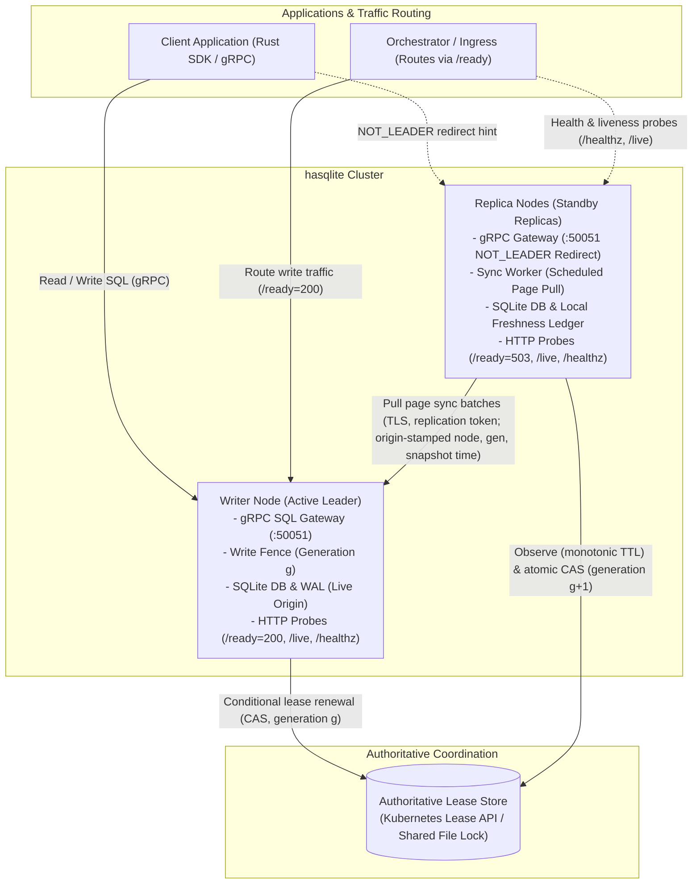
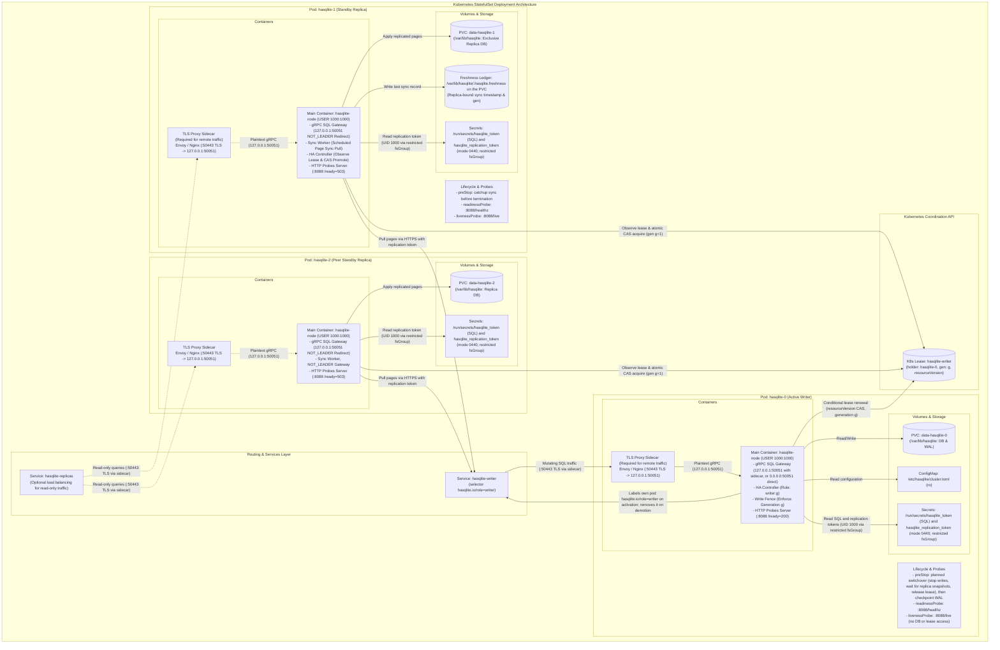
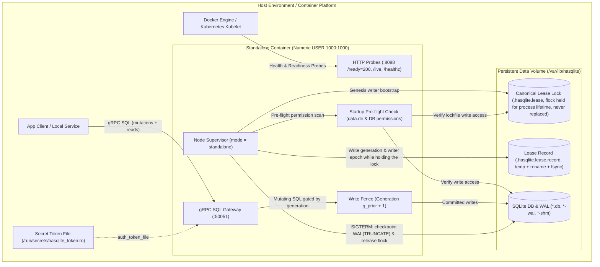

# hasqlite — Development & Test Plan

High Availability SQLite in Rust. This document is the implementation handoff:
architecture, phased delivery, crate layout, and a test matrix informed by
production patterns already demonstrated in
[`rsqlite-rsync`](https://github.com/sria91/rsqlite-rsync). The current
`hasqlite-sync` replication path depends on `rsqlite-rsync`; removing that
dependency after a native implementation is ready is an explicit architectural
goal, not a claim about the current build.

---

## 1. Goals and future goals

### Goals

1. **Single logical writer** at all times, with **lease-backed fencing** and
   **generation monotonicity** (no split-brain writes).
2. **Fast failover** (target: low-second RTO) with **bounded RPO** via
   incremental rsync-style page sync from the current writer snapshot.
3. **Operator-grade** observability: audit log, readiness/liveness semantics,
   metrics, and Kubernetes-first deployment paths.
4. **Application API**: SQL over gRPC on the writer; safe redirect on replicas;
   Rust client with automatic `NOT_LEADER` failover that never silently retries
   a write whose outcome is unknown; the client and wire API will ultimately be
   owned by hasqlite.
5. **Library-first**: embed the HA controller in custom agents; ship a
   batteries-included `hasqlite` node binary.
6. **First-class standalone single-node Docker support (fast-track)**: Out-of-the-box
   capability to run a single `hasqlite` node in a standalone Docker container
   (file-based lease or auto-granted genesis lease, zero peer dependencies, gRPC SQL gateway,
   HTTP probes) for local development, edge, and single-host production before multi-node failover.

### Future goals (non-goals for v1)

- Multi-writer / distributed SQL consensus (Raft, Paxos, SQLite session
  extension).
- Cross-region active/active.
- Drop-in compatibility with the `rsqlite-rsync` standalone sync CLI. hasqlite
  will provide its own commands and implementation. Note: running `hasqlite`
  *itself* as a standalone single-node database
  service in Docker is explicitly a goal and fast-tracked (see §1.6 and §5 Phase 1b).
- Built-in TLS termination on the gateway (document mesh/proxy patterns instead).

### Success criteria (v1.0)

| Metric | Target |
|--------|--------|
| Split-brain write window | 0: no node commits after its renewal deadline, which precedes any candidate's TTL by the fencing margin (§3 Lease timing; assumes no single commit stalls longer than the margin) |
| Steady-state sync interval | Configurable 1–5s default |
| Promotion block on stale replica | 100% when lag behind the activated writer's last renewal > `freshness.max_lag_secs`, or the ledger is not from that writer epoch |
| Failover under synthetic load | RTO p95 < 15s on 3-node k3s (node-local disk) with default lease timing (TTL 10s, renew deadline 6s, retry 2s) |
| Data after planned switchover | Page-hash match vs writer at switchover |
| Data after unplanned failover | New writer holds a prefix of acknowledged writes; loss window ≤ `max_lag_secs` + `renew_deadline_secs` |

---

## 2. Prior art from rsqlite-rsync (carry forward concepts)

### Proven building blocks

| Building block | Location in rsync | hasqlite action |
|----------------|-------------------|-----------------|
| Two-pass page hash sync (v2 BLAKE3) | `protocol`, `hash`, `transport` | Use the current crate integration as a bridge; implement and test the required behavior natively before removing it |
| Live origin, exclusive replica | `snapshot`, sync invariants | Document as hard cluster invariants in `safety-contract.md` |
| Lease record + KV text formats | `ha.rs`, `kv_text` | Extract/shared types in `hasqlite-lease` |
| Freshness ledger + promotion gates | `validate_promotion`, `enforce_write_fence` | Core of `hasqlite-controller` |
| File + Kubernetes lease readers | `FileLeaseReader`, `KubectlLeaseReader` | Pluggable `LeaseSource` trait |
| HA reconcile loop + audit | `HaController`, `HaRuntime` | Node supervisor in `hasqlite-node` |
| SQL Gateway + Replication gRPC | `gateway`, protobuf API | Implement in the hasqlite node and own the protocol definitions |
| Client failover | Existing client API | Provide a native `hasqlite-client` with first-class failover |
| K8s examples + runbooks | `docs/k3s-*`, `examples/k8s/` | Port to `deploy/k8s/` with hasqlite-specific naming |
| Integration test patterns | `ha_mode`, `grpc_failover`, `live_writes` | Mirror suite under `hasqlite/tests/` |

### Pain points to fix in hasqlite

1. **HA logic buried in a sync monolith** — harder to version, test, and embed.
2. **Operational split** — sync sidecar, lease updater, and `--ha` process are
   multiple moving parts in manifests; consolidate into one **node agent** with
   clear subtasks (lease, sync, gateway, probes).
3. **Readiness pitfalls** — `/ready` only passes on writer; document and encode
   StatefulSet rollout strategy in deploy templates (use `/healthz` for rollout,
   writer pod label for routing).
4. **Auth vs fencing** — keep bearer auth mandatory by default; fencing is
   correctness, not authentication. SQL and replication use separate credentials.

---

## 3. Architecture

### Simplified architecture block diagram



### Detailed cluster interaction topology

```mermaid
flowchart TB
  subgraph apps ["Applications & Traffic Routing"]
    APP["Client Application (Rust SDK / gRPC)"]
    ROUTER["Orchestrator / Ingress / Proxy (K8s Service / Envoy)"]
  end

  subgraph cluster ["hasqlite HA Cluster"]
    subgraph writer ["Writer Node (Active Leader)"]
      W_GW["gRPC SQL Gateway (:50051)"]
      W_FENCE["Write Fence (Generation g)"]
      W_DB[("SQLite DB & WAL (Live Origin)")]
      W_CTRL["HA Controller (Role: writer:g)"]
      W_PROBE["HTTP Probes (:8088 /ready=200, /live, /healthz)"]
    end

    subgraph r1 ["Replica Node 1 (Candidate / Standby)"]
      R1_GW["gRPC SQL Gateway (:50051)"]
      R1_SYNC["Sync Worker (Scheduled Pull)"]
      R1_DB[("SQLite DB (Exclusive Replica Target)")]
      R1_LEDGER[("Freshness Ledger (Replica-Bound Storage)")]
      R1_CTRL["HA Controller (Promotion Gate & CAS)"]
      R1_PROBE["HTTP Probes (:8088 /ready=503, /live, /healthz)"]
    end

    subgraph r2 ["Replica Node 2 (Peer Standby)"]
      R2_GW["gRPC SQL Gateway (:50051)"]
      R2_SYNC["Sync Worker (Scheduled Pull)"]
      R2_DB[("SQLite DB (Exclusive Replica Target)")]
      R2_LEDGER[("Freshness Ledger (Replica-Bound Storage)")]
      R2_CTRL["HA Controller (Standby Reconcile)"]
      R2_PROBE["HTTP Probes (:8088 /ready=503, /live, /healthz)"]
    end
  end

  subgraph coord ["Authoritative Coordination"]
    LS[("Authoritative Lease Store (K8s Lease API / Shared File Lock)")]
  end

  APP -->|"Read/Write SQL (gRPC)"| W_GW
  APP -.->|"Mutating SQL rejected (NOT_LEADER + redirect hint)"| R1_GW
  APP -.->|"Optional stale read (if allow_replica_reads=true)"| R1_GW
  R1_GW -.->|"Automatic client failover to new writer"| APP

  ROUTER -->|"Route write traffic (/ready=200)"| W_PROBE
  ROUTER -.->|"Write traffic blocked (/ready=503)"| R1_PROBE
  ROUTER -.->|"Pod lifecycle & rolling update (/healthz, /live)"| R1_PROBE
  ROUTER -.->|"Pod lifecycle & rolling update (/healthz, /live)"| R2_PROBE

  W_GW -->|"Mutating SQL gated by generation g"| W_FENCE
  W_FENCE -->|"Committed writes"| W_DB
  W_CTRL -->|"Supervises active role"| W_GW
  W_CTRL -->|"Sets probe readiness (/ready=200)"| W_PROBE
  W_CTRL -->|"Conditional lease renewal (CAS, generation g); stop commits at renew deadline"| LS

  R1_SYNC -->|"Pull page sync batches (TLS for remote origins)"| W_DB
  R1_SYNC -->|"Apply consistent snapshot"| R1_DB
  R1_SYNC -->|"Invalidate, apply, fsync, then record origin-stamped synced_at_secs, source node & gen"| R1_LEDGER

  R2_SYNC -->|"Pull page sync batches (TLS for remote origins)"| W_DB
  R2_SYNC -->|"Apply consistent snapshot"| R2_DB
  R2_SYNC -->|"Invalidate, apply, fsync, then record origin-stamped synced_at_secs, source node & gen"| R2_LEDGER

  R1_CTRL -->|"Observe lease (holder, gen, TTL)"| LS
  R1_CTRL -->|"validate_promotion() (writer epoch, lag vs writer renewal, binding, skew)"| R1_LEDGER
  R1_CTRL ==>|"On lease expiry (version unchanged for TTL, local monotonic clock): CAS acquire (g to g+1), then CAS activate"| LS
  R1_CTRL -.->|"On activation: open DB, set /ready=200"| R1_DB

  R2_CTRL -->|"Observe lease (holder, gen, TTL)"| LS
  R2_CTRL -->|"validate_promotion() (writer epoch, lag vs writer renewal, binding, skew)"| R2_LEDGER
  R2_CTRL -.->|"Lost CAS race fails closed (StayReplica)"| LS
```



### Kubernetes pod and container deployment architecture



> **Container & Sidecar Model in hasqlite**:
>
> - **Consolidated Primary Container (`hasqlite-node`)**:
>   Unlike legacy setups that split the synchronization sidecar, lease updater daemon, and HA runtime into separate processes, `hasqlite` consolidates all node responsibilities into a single node agent container running as non-root numeric `USER 1000:1000`. The container hosts the gRPC SQL Gateway, HA Controller reconcile loop, page sync worker, and HTTP health probes.
>
> - **TLS Termination Reverse Proxy Sidecar (Required for Remote Sync)**:
>   The `hasqlite` gRPC Gateway does not provide built-in TLS termination. Remote replication origins must use `https://` and a TLS endpoint (for example, a TLS sidecar on `:50443`); plaintext `grpc://` origins are accepted only for loopback connections. Replicas mount the replication credential Secret (separate from the SQL gateway token) so the sync worker can authenticate its pull requests. The sidecar forwards decrypted requests to `127.0.0.1:50051`, so a loopback gateway bind is *not* local-only here; this is why `gateway.allow_unauthenticated` is rejected in clustered mode. Internal certificates (for example for `hasqlite-writer`) come from a private CA, which requires `sync.tls_ca_file` (native transport, §5 Track N): the transitional adapter trusts only public WebPKI roots.
>
> - **No lease updater sidecar in v1**:
>   `hasqlite-node` talks to the Kubernetes Lease API (`coordination.k8s.io/v1`) in-process. A separate lease-holding sidecar would make the lease holder a different process from the writer: a wedged node agent behind a healthy sidecar would never fail over, and an agent reading a bridged lease file would act on a stale view. Environments that forbid Lease API access are out of scope for v1.
>
> - **Lifecycle Hooks & Probe Separation**:
>   Replica `preStop` hooks attempt a final catch-up sync. The writer's `preStop` hook performs a planned switchover (stop writes, wait a bounded time for replicas to finish a snapshot taken after that point, release the lease), then checkpoints the WAL. `terminationGracePeriodSeconds` must cover drain + final sync + checkpoint. Kubernetes `readinessProbe` queries `/healthz` for pod health; `livenessProbe` queries `/live`, which reports only that the controller loop is running and never touches SQLite or the lease store, so a long checkpoint cannot trigger a restart. A standard Service is not writer-aware, so the node labels its own pod `hasqlite.io/role=writer` on activation and removes the label on demotion; the `hasqlite-writer` Service selects that label. Label updates lag the lease, so routing is best-effort and safety still comes from write fencing and origin identity checks. The optional replica read Service selects replica pods independently. A PodDisruptionBudget with `maxUnavailable: 1` and a rollout that updates replicas first and the writer last (StatefulSet `partition`) keep each rollout to one planned switchover.

### Layers

| Layer | Responsibility | Crate(s) |
|-------|----------------|----------|
| **Data plane** | SQLite files, WAL, hardened SQL gateway engine | `hasqlite-gateway`, `hasqlite-node` |
| **Replication** | Incremental sync scheduler, catch-up on promotion | `hasqlite-sync` (currently integrates `rsqlite-rsync`; native backend is the target) |
| **Control** | Reconcile loop, promotion/demotion, write fence | `hasqlite-controller` |
| **Coordination** | Lease + freshness I/O | `hasqlite-lease` |
| **Wire / API** | Protobuf API, HTTP probes | `hasqlite-proto` (Phase 1a), `hasqlite-probes` |
| **Client** | App SDK | `hasqlite-client` |

### Node roles and state machine

States: `Starting` → `Replica` | `Writer(g)` → `Demoting` → `Replica`.

Events per tick (informed by the upstream `ReconcileDecision` model):

1. Observe lease (holder, generation, version, activated writer epoch). Candidates
   feed the version into a `LeaseObservation`, which measures expiry with the
   local monotonic clock; they never compare the holder's `renewed_at_secs` with
   their own wall clock.
2. Observe freshness ledger (source node ID, source generation, origin-stamped
   snapshot start, destination node ID).
3. Evaluate:
   - If writer: renew (step 4). Commits are allowed only before the renewal
     deadline (see *Lease timing and write fencing*).
   - If replica and the lease is released, or its version has been unchanged for
     `lease.ttl_secs` on the local monotonic clock: run `validate_promotion`
     against the observed lease. The ledger must be bound to this node, come from
     the lease's activated writer epoch (same node and generation), lag that
     writer's last renewal by at most `freshness.max_lag_secs`, and not be stamped
     more than `max_future_skew_secs` in the future. Both lag timestamps come from
     the writer's clock, so detection delay and cross-node skew do not affect the
     result. A whole-cluster cold restart therefore promotes the freshest
     replica without operator action.
   - Freshest replica first: an eligible candidate waits
     `retry_period_secs × lag_secs / max_lag_secs` before its acquisition attempt
     and aborts if the lease version changes meanwhile, so the least-lagged
     replica normally wins the race.
   - From the moment it decides to campaign until it promotes or stays a
     replica, the candidate pauses scheduled sync, so its validated ledger cannot
     change.
4. Lease writes are compare-and-swap operations on the lease version (Kubernetes
   `resourceVersion`, or a write counter in the file lease record):
   - **Acquire** (candidate): succeeds only if the version is unchanged since
     the observation. The store sets `holder = self` and
     `generation = observed + 1`; the caller never supplies the generation. The
     activated writer epoch is left unchanged.
   - **Activate** (new holder, before opening a writable handle): a CAS that
     records the writer epoch `(self, generation, now)`.
   - **Renew** (writer): succeeds only if the version is unchanged since the
     writer's last successful lease write, `holder == self`, and the generation
     is unchanged. It also refreshes the writer epoch's renewal time.
   - **Release** (planned switchover): same conditions as renew; clears the
     holder, keeps the generation, refreshes the writer epoch's renewal time.
   - A lost acquire means `StayReplica`. A conflict on activate, renew or
     release means immediate `Demote`; a writer never overwrites a newer holder.
   - No second freshness check after a won CAS: validation inputs are frozen
     while campaigning. Before opening the writable handle the node only
     confirms that activation succeeded and its renewal deadline has not passed.
   - An acquired but never-activated generation (winner crashed or lost the
     lease) leaves the previous writer epoch in place, so peers synced from that
     writer stay promotable. A writer that activates and then dies before any
     replica syncs from it blocks automatic promotion (fail closed; see the
     manual promotion runbook).
5. Decide: `KeepWriter`, `Promote`, `Demote`, `StayReplica`, `NoOp`.
6. Execute actions:
   - On `Promote` (strictly gated by acquire and activate success): optional
     catch-up from a peer whose ledger has the same writer epoch and a newer
     snapshot, then open writable handle, activate generation write fence, update
     role file to `writer:<gen>`, label the pod, append audit, update probes
     (`/ready`). The sync engine refuses to run once the role is `Writer`.
   - On `Demote`: `sqlite3_interrupt` in-flight statements, close writable
     handles, remove the pod label, update role file to `replica`, update probes.
     Before the first resync, preserve the database as `*.diverged-g<gen>`.
   - On `StayReplica`: trigger scheduled sync pull from current writer if due.

### Lease timing and write fencing

| Setting | Default | Meaning |
|---------|---------|---------|
| `lease.ttl_secs` | 10 | Candidates treat the lease as expired after its version is unchanged this long (local monotonic clock) |
| `lease.renew_deadline_secs` | 6 | The writer stops accepting commits this long after *sending* its last successful renewal |
| `lease.retry_period_secs` | 2 | Interval between renewal and acquisition attempts |

A candidate can only see a renewal after the writer sent it, so the writer's
deadline always falls before any candidate's TTL can elapse.
`ttl_secs − renew_deadline_secs` is the fencing margin (validated ≥ 2s). It
absorbs commit latency and process stalls. `enforce_write_fence` runs inside the
write transaction immediately before `COMMIT`, and the controller calls
`sqlite3_interrupt` at the deadline. Each node writes its own disk and nothing
at the storage layer rejects stale generations, so a stall *inside* a commit
longer than the margin can still produce a commit after a peer has promoted.
This residual risk is stated in the safety contract and exercised by the
pause-injection chaos tests.

**Invariants** (tested continuously):

- At any instant at most one node accepts commits, across all generations (subject to the fencing margin above).
- Single-writer promotion guarantee: promotion strictly requires prior success of an atomic acquire CAS incrementing the generation counter, followed by a successful activate CAS; lost CAS races fail closed (`StayReplica`).
- Live-holder preservation: a renewal occurring between candidate observation and acquisition CAS prevents replacement of the live holder, and a renewal by a superseded writer fails instead of overwriting the new holder.
- No commit after the writer's renewal deadline; no SQL write accepted unless `enforce_write_fence` passes for the current generation.
- Promotion rejected when `validate_promotion` fails (lag, writer-epoch mismatch, unbound or self-sourced ledger, future timestamp).
- Replica DB not written except by sync engine (exclusive replica); writer DB never written by the sync engine.

### Standalone single-node mode (Docker / edge / local)

While `hasqlite` is primarily an HA clustering engine, single-node standalone operation
is supported as an explicit first-class operational mode:



- **Direct genesis writer bootstrap**: In standalone mode (`mode = "standalone"` in `[node]` or CLI `--mode standalone`),
  the node skips peer freshness checks, acquires writer status via the authoritative file lease (`LeaseRecord`), and transitions
  directly from `Starting → Writer(g)`, bypassing the intermediate `Replica` state. Standalone configurations strictly require
  `lease.source = "file"`; Kubernetes lease backends are rejected because they do not provide single-node host filesystem mutual exclusion.
- **Generation continuity & authoritative source of truth**: The lease record (`LeaseRecord` stored in
  `${data.dir}/.hasqlite.lease.record`) is the authoritative source of truth for writer identity and generation
  (per `docs/safety-contract.md` rule 2).
  - **First boot**: On a fresh volume with no prior lease file or database state, initial generation is explicitly `1`.
  - **Volume reuse**: When bootstrapping on an existing volume, the node reads the prior lease generation `g_lease`
    and the generation recorded in hasqlite's metadata file `${data.dir}/.hasqlite.meta` (`g_meta`), setting
    `g_prior = max(g_lease, g_meta)`. hasqlite never stores its generation in `PRAGMA user_version`, which
    application migration tools own.
  - **Monotonic lease acquisition**: Standalone bootstrap writes an updated `LeaseRecord` with `generation = g_prior + 1`
    (or `1` if `g_prior == 0`) and an activated writer epoch for itself while holding the lock, guaranteeing generation
    monotonicity.
    When migrating the volume into an HA cluster, a fenced migration procedure seeds the new authoritative Kubernetes
    lease (e.g. lease metadata annotation/counter) with `g_prior` from the standalone file lease before any cluster CAS
    acquisition begins. This preserves the generation invariant in the safety contract (rule 3) so switching coordination
    backends cannot reset the generation or allow competing lease updates during transfer.
- **Mutual exclusion via canonical lock identity on shared volume**: Standalone configurations enforce exactly one
  canonical lock identity per database volume: `${data.dir}/.hasqlite.lease`. `ClusterConfig::validate()` strictly
  rejects configurations specifying any other `lease.file.path`. Allowing arbitrary paths on the volume would risk two
  containers configuring different file names (e.g. `lease.txt` vs `lock.file`), acquiring independent advisory locks on
  different inodes, and causing split-brain write corruption against the same database. By enforcing the single canonical
  path, every standalone container sharing the database volume contends for the exact same file inode, ensuring any
  concurrent instance immediately fails fast with `EWOULDBLOCK`. The lock rules that keep this true:
  - The lock file `.hasqlite.lease` is **never replaced, renamed or deleted**. An atomic write-temp-then-rename would
    leave the holder locking an unlinked inode while a second container locks the new one. The record lives in a
    separate file, `.hasqlite.lease.record`, written by temp file + rename + directory fsync while the lock is held.
  - The lock is taken with `flock(LOCK_EX | LOCK_NB)` (or open-file-description locks) on a descriptor held for the
    process lifetime. Process-associated `fcntl` locks are never used, because closing *any* descriptor on the file
    releases them. `flock` and `fcntl` locks do not exclude each other, so the two are never mixed.
  - The pre-flight check calls `statfs` on `data.dir` and refuses NFS, CIFS/SMB and FUSE filesystems, where neither
    advisory locks nor SQLite locking are reliable across hosts. Standalone mode therefore requires a local filesystem.
- **Zero-sync overhead**: Peer replication loops are dormant; write fence is active locally for writer generation `g`.
- **Graceful shutdown on `SIGTERM`**: Handles container stop signals within Docker's default 10s grace window through an
  ordered shutdown sequence:
  1. **Stop accepting requests**: Demote HTTP probe readiness (`/ready` returns 503) and reject incoming gRPC gateway calls
     with `UNAVAILABLE`.
  2. **Drain in-flight writes**: Drain active transactions and in-flight queries up to a bounded timeout (e.g., 5 seconds).
  3. **WAL checkpoint truncate**: Execute a blocking SQLite WAL checkpoint via `sqlite3_wal_checkpoint_v2(..., SQLITE_CHECKPOINT_TRUNCATE, ...)`
     to flush all committed database pages from the WAL into the primary database file and truncate the WAL file to zero bytes.
  4. **Deadline & fallback handling**: If `SQLITE_CHECKPOINT_TRUNCATE` cannot complete before the shutdown deadline (e.g., blocked
     by lingering reader locks or slow I/O, returning `SQLITE_BUSY`), the node logs a warning, falls back to a non-blocking passive
     checkpoint (`SQLITE_CHECKPOINT_PASSIVE`) without truncating, and cleanly proceeds with shutdown. SQLite WAL crash recovery will
     safely replay any remaining committed WAL frames on the next startup.
  5. **Release lease**: Release the advisory POSIX file lock (`flock`) and exit cleanly with status code 0.

  The binary runs as PID 1 in the container, where the kernel installs no default `SIGTERM`/`SIGINT` handling, so the
  node installs explicit handlers (`tokio::signal`) rather than relying on an init shim.
- **Docker container runtime**: Designed to run inside standard Docker containers with a persistent
  volume mount at `/var/lib/hasqlite`, running under a configurable non-root user and group (defaulting to `hasqlite:hasqlite` with UID/GID `1000:1000` via build arguments `USER`/`GROUP`/`UID`/`GID`), using numeric `USER ${UID}:${GID}` (disallowing root `UID=0`) for compatibility with Kubernetes `runAsNonRoot: true` and OCI security policies, exposing:
  - gRPC SQL Gateway (`0.0.0.0:50051` in container, mapped to host loopback `127.0.0.1:50051:50051` via Docker) for read/write queries.
  - HTTP Probes (`:8088` `/ready`, `/live`, `/healthz`), also published on host loopback (`127.0.0.1:8088:8088`).
- **Seamless cluster upgrade path**: Upgrading from a standalone deployment to an HA cluster requires cleanly stopping
  and fencing the standalone writer before creating or acquiring writer authority under the new coordination backend
  (e.g., Kubernetes Lease API). Because the standalone file lock and Kubernetes Lease API are independent coordination
  mechanisms, running both concurrently without prior fencing would create a dual-writer split-brain hazard. The migration
  procedure requires: (1) terminate the standalone container and verify the POSIX lock is released, (2) inspect the standalone
  lease record to seed the initial generation `g_k8s = g_prior` and the activated writer epoch on the Kubernetes Lease
  object, and (3) launch the HA cluster nodes under Kubernetes lease coordination. The first node is seeded through the
  genesis procedure from the standalone database; the others join as replicas and sync before they are eligible to
  promote.

---

## 4. Repository layout

```
hasqlite/
  Cargo.toml                 # workspace
  crates/
    hasqlite-core/           # shared types, config, errors
    hasqlite-lease/          # LeaseRecord, FreshnessLedger, sources
    hasqlite-controller/     # reconcile, plan, execute (pure logic)
    hasqlite-sync/           # scheduler, hooks, transitional replication adapter
    hasqlite-probes/         # HTTP /ready, /live, /healthz
    hasqlite-proto/          # wire API: SQL gateway + replication services (Phase 1a)
    hasqlite-gateway/        # hardened SQL engine: classification, authorizer, limits (Phase 1b)
    hasqlite-client/         # Rust client with NOT_LEADER failover
    hasqlite-node/           # runtime: tokio supervisor, gateway bind
  hasqlite/                  # binary CLI (package name hasqlite)
  deploy/
    docker/                  # Multi-stage Dockerfile, docker-compose.standalone.yml
    k8s/                     # StatefulSet, RBAC, lease, sync contract
  docs/
    PLAN.md                  # this file
    safety-contract.md
    runbooks/
  tests/
    integration/             # multi-process, filesystem lease
    chaos/                   # fault injection (feature-gated)
  benches/
```

### Dependency-removal plan

`hasqlite-sync` currently uses the `rsqlite-rsync` v0.5.0 Git dependency, pinned
by commit `rev` rather than the movable tag, for replication pulls (CI builds with
`--locked`); its integration test also uses the upstream server and
protocol types. Keep this dependency only as a bridge while hasqlite builds its
own implementation. Do not treat the current wrapper as the final architecture
or expand the upstream dependency into control, gateway, or client crates.

Remove the dependency only after all of the following are true:

1. A hasqlite-owned backend provides the required consistent snapshot, page
   comparison/transfer, transport, authentication, and error behavior.
2. `hasqlite-sync` and end-to-end tests exercise the native backend, including
   live writes, authentication failures, convergence, and failure handling;
   they no longer instantiate upstream server or protocol types.
3. The hasqlite client and wire/API definitions needed by the product are
   implemented and tested without upstream crates.
4. `cargo tree --workspace` contains no `rsqlite-rsync` packages, the lockfile
   no longer records its Git source, and a clean workspace build/test passes
   without access to the sibling repository or upstream Git repository.

Until that cutover, treat `rsqlite-rsync` API usage as an adapter boundary and
keep it isolated to `hasqlite-sync`. Map backend failures into hasqlite-owned
error types at that boundary; public `hasqlite-sync` errors must not expose
upstream types. Test consumers against the owned error types, not the adapter's
implementation errors.

### Extraction strategy (from monolith)

| Phase | Action |
|-------|--------|
| E0 | Define hasqlite-owned interfaces and isolate current upstream calls in `hasqlite-sync` |
| E1 | Implement and test lease, promotion, and reconcile behavior in this workspace |
| E2 | Implement native replication, protocol, and client behavior; run a differential suite that applies the same workloads through the adapter and the native backend and compares page hashes, plus failure tests |
| E3 | Switch production and integration tests to the native backend; remove the upstream dependency and lockfile entries |
| E4 | Release hasqlite independently, with upstream references retained only as prior art |

Dependency removal is a release-readiness goal and is gated by the criteria
above; intermediate milestones may continue using the pinned adapter.

---

## 5. Development phases

### Phase 0 — Bootstrap (week 1)

- [x] Sibling repo + workspace skeleton
- [x] CI: `cargo fmt`, `clippy -D warnings`, `cargo test`, `cargo doc` (all with `--locked`)
- [x] `hasqlite-core`: `NodeId`, `ClusterConfig`, error types
- [x] Document safety contract (draft)

**Exit:** empty crates compile; PLAN approved.

### Phase 1 — Controller parity (weeks 2–4)

Implement native equivalents of the required pure HA logic in
`hasqlite-controller` and `hasqlite-lease`, using the prior implementation as a behavioral reference:

- `parse_lease_record`, `parse_freshness_ledger` (mandatory destination binding, non-empty source attribution)
- `LeaseObservation` (candidate-side expiry on the local monotonic clock) and `RenewalDeadline` (writer-side commit cutoff)
- `validate_promotion` against the observed lease's activated writer epoch, and `enforce_write_fence` checked before `COMMIT`
- Lease store trait with conditional operations only; the store, not the caller, derives the new generation:
  - `acquire(observed: &VersionedLease) -> Result<VersionedLease, LeaseCasError>` (generation + 1, writer epoch unchanged)
  - `activate(held: &VersionedLease)` (records the writer epoch before a writable handle opens)
  - `renew(held: &VersionedLease)` and `release(held: &VersionedLease)` (require unchanged version, `holder == self`, unchanged generation)
- `FileLeaseSource`: never-replaced lock file under `flock`, record file written by temp + rename + fsync, version = record write counter. This is the only I/O in Phase 1 and is required by Phase 1b.
- `HaController::tick` equivalent with injectable `LeaseSource` / `FreshnessSource` / `Clock`, gating promotion on acquire and activate success and delaying each candidate's attempt in proportion to its lag
- `ControllerPlan` + `execute_controller_plan` with test doubles modeling concurrent promotion races where multiple replicas observe an expired lease simultaneously

Deliverables:

- ≥95% line coverage on `hasqlite-controller` and `hasqlite-lease`, enforced by the CI `coverage` job; every `PromotionError` and `LeaseCasError` variant has a test (see §6.1)
- Property tests for generation monotonicity, atomic CAS success/loss races, and lease observation expiry
- Race tests: a renewal between observation and acquisition prevents replacement of the live holder; a superseded writer's renewal fails and demotes it
- Single-winner verification: dual replica failover simulation asserting exactly one node promotes
- Deterministic simulation harness (§6.1b) running the controller against an in-memory lease store
- No SQLite I/O in these crates (fast CI)

### Phase 1a — Wire API (week 3, alongside Phase 1)

`hasqlite-proto` defines the hasqlite-owned API before any of it ships:

- SQL gateway service: statements, batches, `NOT_LEADER` with redirect hint (current holder's advertised address) and current generation; responses distinguish "rejected before execution" from "outcome unknown" so clients know when a retry is safe; optional idempotency key on mutating requests
- Replication service: stream header carrying origin node ID, lease generation and snapshot start time (origin clock); the origin refuses to serve unless it is the current lease holder and activated writer
- Separate credentials: replication requests authenticate with `replication.auth_token_*` (server side) / `sync.transport_auth_token_*` (client side), never with the SQL token; constant-time comparison
- Protocol version field with a stated compatibility rule (version N serves N-1 clients and replicas) so rolling upgrades work

Deliverables: proto definitions, compatibility tests between adjacent versions.

### Phase 1b — Fast-track: Standalone single-node & Docker (weeks 4–5)

*Delivered right after Phase 1 and 1a, unlocking a usable standalone Docker container weeks
ahead of multi-node replication and clustering.*

Scope:
- Multi-stage `Dockerfile` (optimized Rust musl/debian-slim build, configurable non-root UID/GID defaulting to 1000:1000 via `ARG UID=1000` and `ARG GID=1000`, persistent volume mount at `/var/lib/hasqlite`):
  - The final stage needs no `/etc/passwd` entry: it sets numeric `USER ${UID}:${GID}` and creates `/var/lib/hasqlite` with `COPY --chown=${UID}:${GID}` from the builder stage. This works on distroless and musl bases that have no `/bin/sh` or `groupadd`. `ARG USER`/`ARG GROUP` (default `hasqlite`) add named entries only in the debian-slim variant.
  - Disallows root builds (`UID=0` or `GID=0` validation check in the builder stage).
  - Numeric `USER` guarantees compatibility with Kubernetes `runAsNonRoot: true` and OCI security scanners.
- `deploy/docker/docker-compose.standalone.yml` (with `stop_grace_period` covering the shutdown sequence) and container quickstart scripts with host volume permission guidance for default and custom UID/GID execution.
- `hasqlite-gateway` SQL engine hardening (safety contract rule 17):
  - Statements are classified with `sqlite3_stmt_readonly()` after preparation, never by inspecting SQL text.
  - An authorizer callback denies `ATTACH`, `DETACH`, `VACUUM INTO` and pragmas outside an allowlist.
  - `SQLITE_DBCONFIG_DEFENSIVE` on, extension loading off, `trusted_schema` off, and `sqlite3_limit` caps on SQL length and attached databases.
  - A progress handler bounds statement run time; `sqlite3_interrupt` aborts in-flight statements on demotion or shutdown.
  - Database names are resolved strictly inside `data.dir` (no traversal, no symlinks leaving it).
- Standalone mode profile in `hasqlite-core` and `hasqlite-node`:
  - `mode = "standalone"` in `ClusterConfig` (or `--mode standalone` CLI / `HASQLITE_MODE=standalone`).
  - Comprehensive pre-flight check during node startup:
    - Refuses network and FUSE filesystems for `data.dir` (`statfs`).
    - Discovers all supported database files across `data.dir` (root and nested paths matching SQLite conventions such as `*.db`, `*.sqlite`, `*.sqlite3`, plus their `-wal` and `-shm` sidecars) alongside the lease lock and record files.
    - Verifies write permissions on `data.dir`, on each discovered database/sidecar file, and on the parent directory of every database (so SQLite can create WAL and shared-memory files in nested paths).
    - Fails fast on the first permission denial, logging the unwritable path, the required operation, and the active UID/GID, instead of surfacing raw SQLite I/O errors later at runtime.
  - Auto-acquire genesis writer lease through `FileLeaseSource` (§3 standalone lock rules), writing an authoritative `LeaseRecord` at `new_gen = g_prior + 1` (defaulting to `1` on first boot, or incrementing `max(g_lease, g_meta)` observed from prior volume state) and an activated writer epoch for itself, without requiring peer sync history or a freshness section.
  - Secret file credential support: `auth_token_file` (or `HASQLITE_GRPC_AUTH_TOKEN_FILE`) for secure credential mounting via Docker secrets or volume files; file-based tokens are the documented default because environment variables are visible in `/proc/*/environ` and pod specs.
  - Minimal node supervisor: bind gRPC SQL gateway engine and HTTP probe server (`/ready`, `/live`, `/healthz`).
  - Graceful shutdown handling: explicit `SIGTERM`/`SIGINT` handlers (PID 1), synchronous `sqlite3_wal_checkpoint_v2(TRUNCATE)`, in-flight connection draining, and lease release within Docker's 10s grace window.

Deliverables:
- Production `Dockerfile` with configurable non-root build arguments and `deploy/docker/docker-compose.standalone.yml`.
- `hasqlite run --mode standalone` or `hasqlite run --config standalone.toml`.
- Standalone container smoke test in CI (`docker build` + boot container + execute SQL via gRPC + assert `/ready` 200 OK), verifying both default and custom UID/GID images, a negative test for fast startup failure on unwritable volumes, a second container on the same volume failing with `EWOULDBLOCK`, and `docker stop` exiting 0 (not 137) within 10s. Feature-gated with `--features=docker-tests`.
- Gateway hardening payload suite (§6.6).

### Phase 2 — Sync orchestration (weeks 5–7)

`hasqlite-sync` orchestration on top of the pinned adapter. Native replication is Track N below; this phase does not
depend on it:

- Policies: `Periodic`, `OnLeaseChange`, `PreShutdown`, `PostPromoteCatchUp`
  - `PostPromoteCatchUp` runs only before the writable handle opens, and only from a peer whose ledger has the same writer epoch and a newer snapshot. The sync engine refuses to run while the node's role is `Writer`.
- Crash-safe ledger publication (safety contract rule 9). The adapter writes pages into the replica file in place, so an interrupted pull leaves a torn file:
  1. Invalidate the ledger and fsync it before the first page is written.
  2. Pull; `pull_replica` fsyncs the replica file and its directory on success.
  3. Publish the new ledger (origin-stamped source node, generation and snapshot start; destination node) by temp file + rename + directory fsync.
  4. The ledger lives on the same filesystem as the database (`/var/lib/hasqlite/.hasqlite.freshness` by default).
- Replica reads (`allow_replica_reads`) use read-only connections that are reopened after each completed sync. Because the adapter can expose torn pages to concurrent readers, `allow_replica_reads` stays unsupported until Track N applies snapshots through staging or under SQLite locking.
- Clustered v1 replicates exactly one database per cluster, so a single ledger describes the whole replica. Standalone mode may still serve several databases.
- Before its first resync after demotion, a node preserves its database as `*.diverged-g<gen>`.
- Backoff and retry configuration for sync batches.

Deliverables:

- Integration tests: writer emits writes → replica converges within N syncs
- `live_writes` convergence test
- Crash-during-apply test (§6.3) showing the node is unpromotable until a full sync completes

### Track N — Native replication backend (weeks 5–12, parallel; gates Phase 4 and M5)

- Native snapshot, page-diff and transfer with a hasqlite-owned pull API (Phase 1a protocol), replacing the adapter integration
- Snapshots applied atomically (staging file + rename, or under SQLite locking), which also makes replica reads safe
- Origin-side snapshot deadline: a stalled replica session is aborted so its read transaction cannot block WAL checkpoints; replication sessions stop before the shutdown checkpoint
- TLS with `sync.tls_ca_file` and optional `sync.tls_server_name` for private-CA certificates, due by week 10: the Kubernetes deployment in Phase 4 depends on it because the adapter trusts only public WebPKI roots.
- Differential suite against the adapter (§4 E2), then dependency removal (§4 criteria)

### Phase 3 — HA cluster supervisor & local 3-node runtime (weeks 7–10)

`hasqlite-node` multi-process cluster runtime:

- Full HA cluster supervisor: background controller tick loop + sync worker task + dynamic gateway failover
- CLI flags mirroring rsync `--ha-*` for migration (deprecation table in docs)
- HTTP probes (`hasqlite-probes`) with Kubernetes readiness vs liveness semantics documented; `/live` never touches SQLite or the lease store
- Writer routing: pod self-labeling (`hasqlite.io/role=writer`) for Kubernetes; for the local and Compose harnesses, an HAProxy front end that health-checks `/ready` provides the stable `sync.origin_endpoint` alias
- Graceful shutdown: replica preStop catch-up sync; writer planned switchover (stop writes, bounded wait for replicas' post-fence snapshots, release the lease), then drain and checkpoint

Deliverables:

- Local 3-node simulation (three data dirs, shared lease file dir on one host; file leases are single-host only)
- Multi-node Docker Compose test harness (`deploy/docker/docker-compose.cluster.yml`)

### Phase 4 — Kubernetes opinionated deploy (weeks 10–12)

- Port `k3s-ha-stack.yaml` → `deploy/k8s/` with hasqlite image/command
- In-process Kubernetes Lease client (no lease updater sidecar in v1). RBAC: `get`/`update` on the hasqlite Lease, `patch` on the StatefulSet's own pods for role labels
- Writer Service selecting `hasqlite.io/role=writer`; PodDisruptionBudget `maxUnavailable: 1`; rollout script that updates replicas first and the writer last via StatefulSet `partition`
- Separate Secrets for the SQL token and the replication token
- Scripts: `apply-stack.sh`, manifest validator test (copy pattern from rsync)
- Runbooks: failover, planned switchover, manual promotion (including a writer that died before any replica synced from it), stale replica rebuild, diverged data recovery

Deliverables:

- k3d CI job (optional, nightly): smoke failover and rolling update under write load
- `docs/runbooks/failover.md`

### Phase 5 — Hardening & release (weeks 12–13)

- Metrics (Prometheus): sync lag, lease holder, promotion denials, origin WAL size
- Soak test harness (24h, scheduled failovers)
- CHANGELOG, version 0.1.0, README quickstart

---

## 6. Test strategy

### 6.1 Unit tests (`hasqlite-controller`, `hasqlite-lease`)

| Area | Cases | Technique |
|------|-------|-----------|
| Lease parsing | empty, `none`, malformed, future renew, missing writer epoch | table-driven |
| K8s lease JSON | holder, generation and writer-epoch annotations, missing fields | hasqlite-owned fixtures, informed by prior-art cases |
| Lease observation | version unchanged for TTL → expired; version change restarts timer; wall-clock jumps have no effect | injected `Instant` |
| Renewal deadline | commit allowed before deadline, refused at and after it | injected `Instant` |
| Promotion | lag at and past the limit, ledger from older writer generation, other source node, unbound or self-sourced ledger, no activated writer, future skew, aborted acquisition keeps previous epoch valid | pure function asserts |
| Write fence | non-writer, deadline passed, generation mismatch | enum `PromotionViolation` |
| Reconcile | steal lease, renew, partition (stale holder), freshest-first attempt delay | state machine scenarios |
| CAS acquisition race | renewal between observation and acquisition | mock lease store (assert CAS fails, holder preserved) |
| Superseded writer | peer acquired g+1, old writer renews | mock lease store (renew fails, writer demotes in the same tick) |
| Action execution | partial failure, continue-on-error | mock executor |

**Property-based** (proptest, mirror `property_tests.rs`):

- Generation never decreases on valid transitions; acquire always yields `observed + 1`; renew, activate and release never change it
- A ledger from any generation other than the writer epoch's is rejected
- Promotion outcome depends only on lag behind the writer's last renewal, never on detection delay

**Coverage target:** ≥95% line coverage on `hasqlite-controller` and `hasqlite-lease`, enforced by the CI `coverage` job
(`cargo llvm-cov --fail-under-lines 95`).

### 6.1b Deterministic simulation (`tests/sim/`)

N controllers run against an in-memory lease store under `turmoil` (or `madsim`) with an injectable `Clock` that provides
per-node monotonic time and a wall clock with configurable skew and jumps. Random partitions, message delays, process
pauses and crashes are injected. Each step checks:

- At most one node is inside its commit window (before its renewal deadline) at any simulated instant
- Generation is monotonic, and every promotion is preceded by acquire and activate successes
- No node promotes with a ledger from anything but the current writer epoch

Seeds are logged for replay. 1,000 seeds per PR, 100,000 nightly.

### 6.2 Integration tests (`tests/integration/`)

| Test module | Purpose | Prior-art analogue |
|-------------|---------|-----------------|
| `local_cluster.rs` | 3 nodes, file lease, promote/failover | `ha_mode.rs` |
| `sync_convergence.rs` | replica converges to writer page hashes | `local_sync.rs` |
| `live_writes.rs` | writes during sync | `live_writes.rs` |
| `gateway_writer_only.rs` | NOT_LEADER on replica | `grpc_gateway.rs` |
| `client_failover.rs` | retry only after a definite `NOT_LEADER`; writer killed after `COMMIT` but before the response surfaces an "outcome unknown" error and no duplicate row | `grpc_failover.rs` |
| `grpc_replication.rs` | native replication transport, origin identity stamping, demoted origin refuses to serve | `grpc_replication.rs` |
| `shutdown_sync.rs` | replica preStop catch-up | new |
| `planned_switchover.rs` | writer preStop releases the lease; a replica promotes without waiting a TTL; page hashes match | new |
| `file_lease_lock.rs` | holder rewrites the record 100 times while a second process gets `EWOULDBLOCK` each time; reopening and closing the lock path inside the holder does not release it; NFS/FUSE `data.dir` refused | new (Phase 1) |
| `gateway_hardening.rs` | §6.6 payload suite on writer and replica | new (Phase 1b) |
| `token_rotation.rs` | rotated token file takes effect on the next pull without restart | `hasqlite-sync/tests/pull_replica.rs` |
| `readonly_replica_reads.rs` | `--allow-replica-reads` with a concurrent reader loop running `PRAGMA integrity_check` during sync (Track N) | gateway flags |
| `docker_standalone.rs` | Standalone single-node container boot (default and custom UID/GID), volume persistence, gRPC SQL CRUD, probe health, second container rejected, clean `docker stop` | new (Phase 1b) |

Run: `cargo test --workspace` (default). Heavy cluster tests gated with
`--features=k8s-tests` or env `HASQLITE_K8S_TESTS=1`. Docker smoke tests gated with
`--features=docker-tests` or env `HASQLITE_DOCKER_TESTS=1` so standard `cargo test` passes
in container-less environments.

### 6.3 Fault injection (`tests/chaos/`, feature `chaos`)

| Scenario | Injection | Expected |
|----------|-----------|----------|
| Partition writer from lease store | block lease file writes / fake kubectl | writer stops commits at its renewal deadline, then demotes |
| Writer process pause | `SIGSTOP` writer for `ttl + 2s`, peer promotes, `SIGCONT` | old writer's renewal fails; zero commits in its audit log after its deadline |
| Clock jump / skew | libfaketime: candidate +30s, writer −30s | no promotion while the writer keeps renewing |
| Lease store unreachable from all nodes | block Lease API | writer demotes within renew deadline; no promotion until the store returns |
| Writer partitioned from replicas only | drop replication traffic | replica lag grows; if the writer then dies, promotion is denied (documented manual runbook) |
| Stale replica promote | artificial old freshness | promotion denied |
| Sync transport failure | break gRPC / wrong token | retry, alert, no promote |
| Crash during page apply | `kill -9` replica at a random page in the fine pass | ledger stays invalidated; promotion denied until a full sync and `PRAGMA integrity_check` pass |
| Disk full | ENOSPC during page apply or ledger publish | ledger stays invalidated; no promotion from that node |
| Stalled replica session | replica stops reading mid-stream for 10× interval | origin aborts the session; WAL can be checkpointed |
| Crash mid-write | SIGKILL writer | new writer after failover; its data is a prefix of acknowledged writes; loss ≤ `max_lag_secs` + `renew_deadline_secs` |
| Aborted promotion | kill the CAS winner between acquire and activate | another replica promotes against the previous writer epoch |
| Full-cluster cold restart | stop all nodes for > TTL, restart | freshest replica promotes automatically |
| Mixed-version rolling upgrade | version N writer with N-1 replicas, and the reverse | replication and failover keep working |
| Dual lease claim | corrupt lease file | single winner via generation rules |

Every chaos and E2E run records client operations (sequence number; acknowledged, failed or outcome unknown) and checks
the history afterwards: acknowledged writes on the surviving writer form a prefix with bounded loss, and no two nodes'
audit logs show commits in overlapping intervals once the fencing margin is accounted for.

### 6.4 Kubernetes / E2E

| Suite | Environment | Frequency |
|-------|-------------|-----------|
| Manifest validate | shell + kubeconform | every PR |
| k3d 3-node failover | CI nightly | nightly |
| k3d rolling update under write load | CI nightly | nightly |
| Soak 24h + periodic kill | staging | pre-release |

Assertions:

- No two pods' audit logs record commits in overlapping intervals (the lease API always shows one holder, so checking it proves nothing)
- History checker (§6.3) passes after every failover
- Page hashes match after planned switchovers; after crash failovers, the prefix property holds
- A rolling update causes at most one failover and loses no acknowledged write

### 6.5 Performance & benchmarks

| Bench | Measures | Tool |
|-------|----------|------|
| `sync_catchup` | bytes moved vs churn | native Criterion benchmark |
| `failover_rto` | promote → first successful write | custom harness |
| `controller_tick` | reconcile latency | criterion |

Use hasqlite-owned sync settings, documented under the `HASQLITE_SYNC_*`
environment variable prefix in the operations guide.

### 6.6 Security tests

- Gateway refuses unauthenticated start without explicit insecure flag; clustered mode rejects `allow_unauthenticated` even on a loopback bind
- Path traversal and symlink escape on `--data-dir` / database name
- Token required on all RPCs (client negative tests); the SQL token is rejected by the replication service and the replication token by the SQL service
- Gateway hardening payloads rejected on writer and replica: CTE-wrapped `INSERT`, comment-prefixed DML, `ATTACH`, `VACUUM INTO`, `PRAGMA writable_schema`, `load_extension`, oversized SQL
- TLS: a private-CA certificate is accepted with `sync.tls_ca_file`; a certificate with the wrong SAN is rejected; there is no plaintext fallback
- Tokens never appear in logs or error messages; tokens rotate without restart

### 6.7 CI matrix

```yaml
# illustrative
jobs:
  fast:
    - cargo test --locked -p hasqlite-controller -p hasqlite-lease
    - cargo test --locked -p hasqlite-sync -- --test-threads=1
  integration:
    - cargo test --workspace --locked
  coverage:
    - cargo llvm-cov --locked -p hasqlite-controller -p hasqlite-lease --fail-under-lines 95
  simulation:
    - cargo test --locked --test sim   # 1,000 seeds per PR, 100,000 nightly
  lint:
    - cargo clippy --workspace --all-targets --locked -- -D warnings
    - cargo fmt --check
  k8s:
    if: nightly
    - k3d cluster create && apply deploy/k8s && run smoke and rolling-update scripts
```

---

## 7. Configuration contract (v1)

Unified config file (TOML/YAML) replacing long flag lists:

```toml
[node]
id = "pod-0"

[data]
dir = "/var/lib/hasqlite"

[lease]
source = "kubernetes" # or "file" (single host only: file leases need a local filesystem)
ttl_secs = 10            # candidates wait this long after the last observed lease change (local monotonic clock)
renew_deadline_secs = 6  # writer stops committing this long after sending its last successful renewal
retry_period_secs = 2    # renewal / acquisition attempt interval

# If lease.source = "file":
# [lease.file]
# path = "/var/lib/hasqlite-lease/lease"

# If lease.source = "kubernetes":
[lease.kubernetes]
lease_name = "hasqlite-writer"
namespace = "default"

[freshness]
path = "/var/lib/hasqlite/.hasqlite.freshness" # on the PVC, same filesystem as the database
max_lag_secs = 8 # max lag of the last snapshot behind the writer's last lease renewal (both on the writer's clock)

[promotion]
max_future_skew_secs = 2

[sync]
interval_secs = 2
# Required in clustered mode on every node, including the current writer: any node can be demoted and
# must then resync. Use a stable alias that always routes to the current writer, never a pod hostname.
origin_endpoint = "https://hasqlite-writer:50443" # remote origins require TLS; grpc:// is limited to loopback IPs and `localhost`
# The TLS certificate must cover hasqlite-writer. Private-CA trust needs the native transport (Track N):
# tls_ca_file = "/run/secrets/hasqlite_ca.crt"
# A credential is required whenever origin_endpoint is set (exactly one of the two settings below).
# Prefer the file: environment variables are visible in /proc/*/environ and in pod specs.
transport_auth_token_file = "/run/secrets/hasqlite_replication_token"
# transport_auth_token_env = "HASQLITE_REPLICATION_TOKEN"

# Server-side replication credential, distinct from the SQL gateway token (Phase 1a):
# [replication]
# auth_token_file = "/run/secrets/hasqlite_replication_token"

[gateway]
bind = "0.0.0.0:50051" # Direct listener without sidecar; use "127.0.0.1:50051" when co-located with TLS sidecar (:50443)
auth_token_file = "/run/secrets/hasqlite_token"
# auth_token_env = "HASQLITE_GRPC_AUTH_TOKEN"
# allow_unauthenticated is rejected in clustered mode
allow_replica_reads = false # unsupported until Track N applies snapshots atomically

[probes]
http_bind = "0.0.0.0:8088"
```

CLI: `hasqlite run --config cluster.toml` plus env overrides.

Validation (`ClusterConfig::from_toml`) fails closed:

- Unknown keys or sections are rejected, so a misspelled setting cannot silently fall back to its default.
- Clustered mode requires `[freshness]`, `[promotion]`, `[sync]`, and `sync.origin_endpoint`, and
  `freshness.max_lag_secs` must exceed `sync.interval_secs` (otherwise steady-state lag would deny every promotion).
- Lease timing: `retry_period_secs > 0`, `retry_period_secs < renew_deadline_secs`,
  `ttl_secs ≥ renew_deadline_secs + 2` (the fencing margin, §3, computed with checked arithmetic), and
  `ttl_secs ≤ 3600`, which also bounds the writer's renewal deadline.
- Plaintext `grpc://` origins are accepted only for literal loopback IPs and `localhost`; `*.localhost`
  subdomains are rejected because some resolvers forward them upstream, which would expose the token.
- `sync.origin_endpoint` requires a sync credential, and the gateway requires a credential unless
  `allow_unauthenticated = true` is set on a loopback bind in standalone mode. Clustered mode rejects
  `allow_unauthenticated`: the TLS sidecar forwards remote traffic to the loopback listener, which also serves replication.
- Phase 1a adds: the replication credential must differ from the gateway credential (distinct env var names / files).

### Standalone single-node profile (Docker / edge)

For running a single standalone node in Docker without replication peers:

```toml
[node]
id = "standalone-0"
mode = "standalone" # Auto-promotes to genesis writer at generation g_prior + 1 (1 on first boot)

[data]
dir = "/var/lib/hasqlite"

[lease]
source = "file" # Standalone mode strictly requires file-backed lease

[lease.file]
# Standalone mode enforces this exact canonical path within data.dir to guarantee mutual exclusion.
# It is the never-replaced lock file; the record lives in .hasqlite.lease.record next to it.
path = "/var/lib/hasqlite/.hasqlite.lease"

# Note: [freshness], [promotion], and [sync] sections are omitted in standalone mode

[gateway]
bind = "0.0.0.0:50051" # Direct listener; use "127.0.0.1:50051" when co-located with TLS sidecar
auth_token_file = "/run/secrets/hasqlite_token" # Mutually exclusive with auth_token_env
# auth_token_env = "HASQLITE_GRPC_AUTH_TOKEN"
# allow_unauthenticated = false  # standalone only, loopback bind only
allow_replica_reads = false

[probes]
http_bind = "0.0.0.0:8088"
```

### Standalone Docker invocation

> [!NOTE]
> **Phase 1b Target**: The Docker invocation below illustrates the planned deployment workflow once the Phase 1b runtime and packaging land. (In the current Phase 0 repository, the binary outputs a bootstrap log and exits).
>
> All required configuration fields (`node.id`, `data.dir`, `lease.source`, `gateway.bind`, `probes.http_bind`) are supplied by mounting the standalone TOML configuration. In Phase 1b, the image entrypoint will also support synthesizing minimal standalone defaults if config mounts are omitted.
>
> **Configurable Non-Root User & Volume Permissions**: The image defaults to UID:GID `1000:1000` (named `hasqlite:hasqlite` in the debian-slim variant). Custom UID/GID values can be configured at build time using `--build-arg UID=<uid> --build-arg GID=<gid>`; `--build-arg USER=<user> --build-arg GROUP=<group>` set the names where the base image has passwd tooling. Note that build arguments configure the image's internal user identity and default directory permissions, but do not change ownership or permissions on host bind mounts. When mounting a host directory to `/var/lib/hasqlite`, users must ensure the host directory and any existing database/lease files grant write access to the runtime identity (e.g., `chown -R <uid>:<gid> /path/to/host/data`, or assigning group ownership `chgrp -R <gid> /path/to/host/data` paired with `chmod -R 0770 /path/to/host/data`). When running under rootless Docker or user namespace remapping (`userns-remap`), container UIDs/GIDs are translated to subordinate host ID ranges defined in `/etc/subuid` and `/etc/subgid` (or mapped to the rootless daemon user); operators must determine the translated host UID/GID and apply ownership or permissions using those mapped host IDs rather than container-internal values. The image configures numeric `USER ${UID}:${GID}` so runtime `-u` flags are unnecessary unless explicitly overriding the container user at runtime.
>
> **Secret File Permissions**: When using `auth_token_file` or `transport_auth_token_file` with mounted secrets (e.g. `/run/secrets/hasqlite_token`), ensure each node that reads the secret can access it as the configured runtime UID/GID (or mapped host ID under rootless/userns-remap) without exposing credentials to other local users. For Kubernetes pods running as UID 1000, configure a restricted `fsGroup` and use mode `0440` so only the node UID and that group can read the token; do not use world-readable permissions (`0444`).
>
> **Plaintext Gateway & Network Security**: The gRPC SQL Gateway communicates in plaintext in v1 and does not provide built-in TLS termination. The host port mapping binds strictly to host loopback (`127.0.0.1:50051:50051`) to avoid publishing the unencrypted gateway on public interfaces. Any remote or multi-host access MUST traverse an external TLS termination reverse proxy or ingress sidecar (such as Envoy, Traefik, or Nginx).

```bash
# Optional: build with custom non-root user/group and UID/GID (defaults to hasqlite:hasqlite and 1000:1000 if omitted)
# docker build \
#   --build-arg USER=customuser \
#   --build-arg GROUP=customgroup \
#   --build-arg UID=1001 \
#   --build-arg GID=1001 \
#   -t hasqlite:${HASQLITE_VERSION:-0.1.0} \
#   -f deploy/docker/Dockerfile .

docker run -d \
  --name hasqlite \
  -p 127.0.0.1:50051:50051 \
  -p 127.0.0.1:8088:8088 \
  -v /path/to/standalone.toml:/etc/hasqlite/cluster.toml:ro \
  -v hasqlite-data:/var/lib/hasqlite \
  -v /path/to/token.txt:/run/secrets/hasqlite_token:ro \
  hasqlite:${HASQLITE_VERSION:-0.1.0} \
  run --config /etc/hasqlite/cluster.toml
```

---

## 8. Observability

| Signal | Format |
|--------|--------|
| Audit log | append-only JSON lines on the PVC (action, from, to, lease gen, first and last commit time per generation) |
| Role state file | `replica` / `writer:<gen>` (informational; never used as authority) |
| Metrics | Prometheus: `hasqlite_sync_lag_seconds`, `hasqlite_lease_held`, `hasqlite_promotion_denied_total` (by `PromotionError` variant), `hasqlite_renewal_deadline_misses_total`, `hasqlite_origin_wal_bytes` |
| Tracing | `tracing` spans: `tick`, `sync`, `promote` |

Alerts (recommended):

- `sync_lag > freshness.max_lag_secs` for > 2 intervals
- origin WAL size growing across checkpoints
- promotion denied spike
- lease holder missing > TTL

---

## 9. Risks and mitigations

This section distinguishes architectural limitations, expected failure behavior,
and unresolved guarantees. Mitigations and test assertions elsewhere in this
plan are delivery requirements, not evidence that they are already implemented
or verified. The [safety contract](safety-contract.md) remains normative.

### 9.1 Risk summary

| Risk | Mitigation |
|------|------------|
| Stale replica promoted | Lag gate against the writer epoch's last renewal + writer-epoch match + default deny; manual recovery runbook |
| Dual writer during partition | Candidates expire leases on local monotonic time; writer stops commits at its renewal deadline; renewals are CAS; gateway write fence before `COMMIT` |
| Writer stalled inside a commit longer than the fencing margin | Residual risk (no storage-level fence): margin ≥ 2s enforced, pause-injection chaos tests, audit log lets operators detect overlap |
| Torn replica promoted after crash during sync | Ledger invalidated before apply, published only after fsync (Phase 2); atomic apply in Track N |
| Writer dies before any replica syncs from it | Fail closed; manual promotion runbook; alert on lag |
| Lost or duplicated client writes on failover | Client retries only definite `NOT_LEADER`; "outcome unknown" surfaced; idempotency keys |
| Large catch-up after failover | PreStop sync + pre-activation catch-up from a fresher peer; monitor lag |
| Upstream API changes during transition | Pin the adapter by commit, build with `--locked`, isolate it; remove the integration at native-backend cutover |
| StatefulSet rollout stall or repeated failovers | Document `/healthz` vs `/ready`; writer-last rollout with planned switchover; PodDisruptionBudget |

### 9.2 Data safety and durability limitations

| Limitation or failure mode | Consequence and planned protection |
|----------------------------|------------------------------------|
| Asynchronous replication | An unplanned failover can lose acknowledged writes. The target loss window is at most `freshness.max_lag_secs + lease.renew_deadline_secs` (14 seconds with the example configuration), not zero RPO. This is a time-window target, not a bound on the number of lost transactions. |
| No storage-level generation fence | Each node writes its own disk; a generation counter does not physically reject an old writer's disk writes. Split-brain prevention depends on cooperative self-fencing and the timing assumption below. |
| Writer stalls inside `COMMIT` beyond the fencing margin | A commit can finish after a peer promotes. The default margin is 4 seconds and the minimum is 2 seconds. A pre-commit check and `sqlite3_interrupt` do not eliminate this residual risk. |
| Replica crashes during in-place page application | The replica can contain a partially applied snapshot. Invalidate and fsync the ledger before application; deny promotion until a full sync and `PRAGMA integrity_check` pass. Track N provides atomic/locked application. |
| Disk full during page application or ledger publication | Sync fails and the ledger remains invalid; the affected node cannot promote. |
| Former writer contains divergent commits | Preserve its database before resync. Those commits are not automatically merged into the new writer; recovery may require operator reconciliation. |
| Commit completes but its response is lost | The client has an unknown outcome. Blind retries can duplicate operations; surface uncertainty and retry automatically only when rejection before execution is definite. |

SQLite transaction atomicity and replication durability are separate concerns.
Power loss during normal SQLite writes should be recoverable when journaling,
sync settings, and storage behave correctly; that does not make external,
in-place replica page replacement transactional. Nor does local crash recovery
restore writes absent from the promoted replica.

### 9.3 Availability and promotion failure modes

| Condition | Expected behavior or limitation |
|-----------|--------------------------------|
| Writer loses access to coordination | It stops committing at its renewal deadline and demotes, even if its database and client network remain healthy. |
| Lease store is unreachable from all nodes | The writer demotes; no replacement can acquire authority until the store returns. A local expiry timer alone never authorizes promotion. |
| Writer is partitioned from replicas but can renew | Writes continue while replica lag grows. If the writer later fails, all replicas may be too stale to promote. |
| All replicas exceed the freshness limit | Automatic promotion is denied; availability is sacrificed to limit data loss. Manual recovery is required. |
| Activated writer dies before any replica syncs from it | Replicas have the wrong writer epoch and automatic failover is blocked. An acquired but never-activated generation does not have this effect. |
| Ledger is missing, invalid, bound to another destination, self-sourced, or from the wrong writer epoch | Promotion fails closed; apparent file recency is insufficient. |
| Snapshot timestamp exceeds the allowed future skew | Promotion is denied. Lease expiry uses monotonic time, but the promotion future-timestamp check still uses local wall time. |
| Acquisition or activation CAS loses a race | The candidate remains a replica. Acquisition without activation never permits writable SQL handles. |
| Candidate crashes between acquisition and activation | The previous writer epoch remains valid for eligible peers, but another acquisition may have to wait for the abandoned holder's TTL. |
| Writer crashes without releasing the lease | Each candidate waits for an unchanged lease version for a full locally measured TTL before campaigning; failover is not instantaneous. |
| Slow storage, coordination, or catch-up | Recovery can exceed the p95 RTO target of 15 seconds. That target applies to the specified test environment, not every deployment. |
| Lag-proportional election delay | It favors the freshest eligible replica but does not guarantee that replica wins the CAS race. |

### 9.4 Replication and request-serving limits

| Limitation or failure mode | Consequence or requirement |
|----------------------------|----------------------------|
| Single writer | Replicas do not scale write execution; multi-writer SQL and cross-region active/active are outside v1 scope. |
| One replicated database per cluster in v1 | One freshness ledger covers one database. Standalone multi-database serving is not clustered multi-database replication. |
| Replica reads with the transitional adapter | Unsupported because concurrent in-place application can expose torn pages. Track N must provide safe atomic/locked application first. |
| Replica reads after safe application is implemented | Reads can still be stale; they are not automatically equivalent to reading the writer. |
| Sync transport, credential, or TLS failure | Retry and alert; snapshots stop advancing and affected replicas can become unpromotable. |
| Stalled snapshot session | Its read transaction can block WAL checkpoint progress and grow the origin WAL. Track N must enforce a snapshot deadline and stop replication sessions before the shutdown checkpoint. |
| Switchover write-service gap | Requests can be rejected while the old writer stops and a successor activates. The plan does not provide a durable SQL request queue. |
| Final-sync or drain timeout during planned switchover | A timeout does not establish a lossless handover. The intended successor must durably contain every final committed write to meet the planned-switchover target; see unresolved policy in §9.6. |

### 9.5 Deployment, access, and compatibility constraints

| Constraint or failure mode | Consequence or requirement |
|----------------------------|----------------------------|
| File lease backend | Single-host only; not a supported cross-host coordination mechanism. |
| Standalone storage and lock identity | Requires local storage and the canonical, never-replaced lock file. NFS, CIFS/SMB, and FUSE are refused. Independent lock paths or replacing the lock inode can defeat mutual exclusion. |
| Standalone-to-cluster migration | Fence the standalone writer before switching coordination backends and seed generation continuity. File locks and Kubernetes leases do not exclude each other. |
| Kubernetes routing propagation delay | Role labels and Service endpoints can lag leadership. Old connections may still reach the former writer; write fencing, not routing, must reject writes. `/ready=503` alone does not enforce the writer Service's routing. |
| Wrong probes or rollout ordering | Can stall StatefulSet rollout or cause repeated failovers. Use `/healthz` for rollout health, writer-role labels for write routing, and update replicas before the writer. |
| Missing Kubernetes API access or RBAC | Clustered Kubernetes operation requires the in-process Lease client and pod-label permissions. A separate lease updater sidecar is out of scope for v1. |
| Insufficient shutdown grace | Drain, final sync, and checkpoint may be cut short by forced termination. Grace periods must cover the complete sequence. |
| Checkpoint blocked by readers or slow I/O | Shutdown may use the documented passive-checkpoint fallback. Remaining WAL must be preserved for SQLite recovery. |
| Unwritable data paths or incompatible UID/GID | Startup fails with the offending path and required permission rather than serving with partially accessible files. |
| No built-in gateway TLS termination | Remote traffic requires an external TLS endpoint. Plaintext replication origins are restricted to loopback. |
| Private-CA certificates with the transitional adapter | Unsupported by its public-WebPKI-only trust configuration. Native TLS support gates Kubernetes delivery. |
| Authentication requirements | Clustered mode requires authentication even behind a loopback TLS proxy; SQL and replication credentials must be distinct. Unauthenticated mode is limited to standalone loopback use. |
| Restricted SQLite feature surface | `ATTACH`, `DETACH`, `VACUUM INTO`, extension loading, and non-allowlisted pragmas are denied; this is not unrestricted access to every SQLite feature. |
| Rolling protocol compatibility | The stated compatibility window is version N with N-1; arbitrary mixed versions are not promised. |
| Transitional upstream dependency | Keep the adapter pinned and isolated until native cutover. Native replication, runtime integration, deployment tooling, and tests are milestone deliverables, not guarantees supplied by this document alone. |
| Upstream CLI compatibility | Drop-in compatibility with the `rsqlite-rsync` standalone sync CLI is not a v1 goal. |

### 9.6 Unresolved guarantees and recovery policy

The following are gaps to resolve explicitly, not additional guarantees:

- **Arbitrary corruption and storage faults:** the plan does not establish
  comprehensive protection against disk corruption, dishonest flush behavior,
  filesystem faults, or faulty memory. Hash convergence and freshness metadata
  do not prove application-level data correctness.
- **Corrupted-writer recovery:** automatic diagnosis, quarantine, selection of
  a verified healthy recovery source, and repair of an already-corrupted writer
  are not specified end to end.
- **Independent backups and point-in-time recovery:** replication is not a
  substitute for backups; corruption or unwanted logical changes can propagate.
  Backup retention, restore verification, and point-in-time recovery are not
  defined here.
- **Exactly-once execution across failover:** an optional idempotency key alone
  does not specify durable, failover-safe deduplication or its retention window.
  Unknown outcomes must remain visible until such semantics are defined.
- **Lossless switchover on timeout:** specify whether final-sync/drain failure
  aborts handover or enters an explicitly bounded-loss recovery path. Also
  define how the final-snapshot-bearing successor is selected and verified;
  passing the ordinary freshness gate alone is not proof of zero loss.
- **Unbounded pauses:** neither interruption nor a second pre-commit check
  closes the documented stalled-commit window. A stronger guarantee requires
  an enforceable external/storage fence or a different replication/commit
  architecture, not merely a larger timeout.
- **Damaged authoritative lease state:** the dual-claim chaos assertion in
  §6.3 does not define recovery from arbitrary lease corruption or loss.
  Generation rules depend on an intact authoritative history; reconstruction
  must not silently reset generations or bootstrap competing writers.

---

## 10. Milestone checklist (summary)

| Milestone | Deliverable | Tests |
|-----------|-------------|-------|
| M0 | Workspace + PLAN | CI green on empty crates |
| M1 | Controller parity | unit + proptest + simulation + coverage gate |
| M1a | Wire API (`hasqlite-proto`) | adjacent-version compatibility |
| M1.5 (Fast-track) | Standalone Single-Node Docker | Multi-stage Dockerfile, hardened standalone gateway, lock tests, probes |
| M2 | Sync worker | integration convergence + crash-during-apply |
| M3 | HA cluster runtime | 3-node local HA + chaos suite |
| M4 | K8s deploy (requires Track N TLS) | manifest + k3d smoke + rolling update |
| M5 | 0.1.0 release (requires Track N cutover) | soak + security suite |

---

## 11. References

- [rsqlite-rsync README](https://github.com/sria91/rsqlite-rsync/blob/master/README.md)
- [rsqlite-rsync HA guide](https://github.com/sria91/rsqlite-rsync/blob/master/docs/ha-guide.md)
- [k3s HA runbook](https://github.com/sria91/rsqlite-rsync/blob/master/docs/k3s-ha-runbook.md)
- [Protocol](https://github.com/sria91/rsqlite-rsync/blob/master/docs/protocol.md)
- [plan-k3sHaSqliteSync.prompt.md](https://github.com/sria91/rsqlite-rsync/blob/master/.github/prompts/plan-k3sHaSqliteSync.prompt.md)
