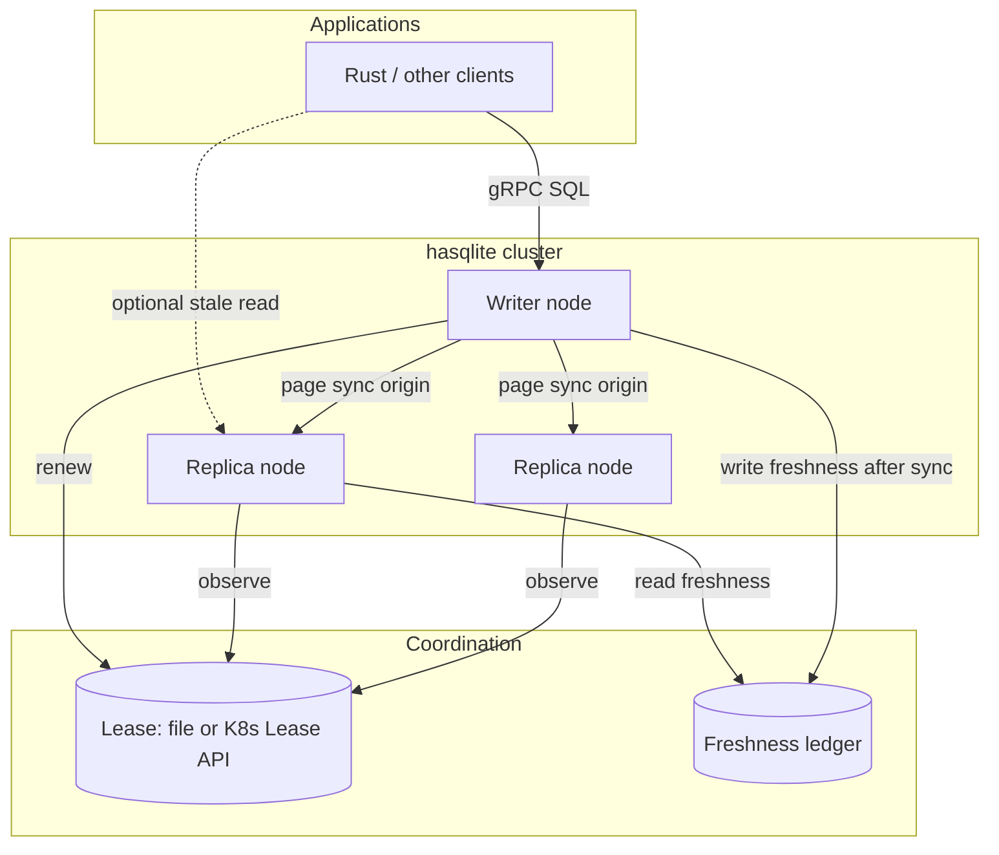

# hasqlite — Development & Test Plan

High Availability SQLite in Rust. This document is the implementation handoff:
architecture, phased delivery, crate layout, and a test matrix derived from
production patterns already proven in
[`rsqlite-rsync`](../../rsqlite-rsync).

---

## 1. Goals and non-goals

### Goals

1. **Single logical writer** at all times, with **lease-backed fencing** and
   **generation monotonicity** (no split-brain writes).
2. **Fast failover** (target: low-second RTO) with **bounded RPO** via
   incremental rsync-style page sync from the current writer snapshot.
3. **Operator-grade** observability: audit log, readiness/liveness semantics,
   metrics, and Kubernetes-first deployment paths.
4. **Application API**: SQL over gRPC on the writer; safe redirect on replicas;
   Rust client with automatic `NOT_LEADER` failover (reuse
   `rsqlite-rsync-client` / shared protobuf).
5. **Library-first**: embed the HA controller in custom agents; ship a
   batteries-included `hasqlite` node binary.

### Non-goals (v1)

- Multi-writer / distributed SQL consensus (Raft, Paxos, SQLite session
  extension).
- Cross-region active/active.
- Replacing rsqlite-rsync’s standalone sync CLI (keep compatibility; call sync
  as a library).
- Built-in TLS termination on the gateway (document mesh/proxy patterns instead).

### Success criteria (v1.0)

| Metric | Target |
|--------|--------|
| Split-brain write window | 0 (detected + fenced) |
| Steady-state sync interval | Configurable 1–5s default |
| Promotion block on stale replica | 100% when freshness age > threshold |
| Failover under synthetic load | RTO p95 < 15s on 3-node k3s (node-local disk) |
| Post-failover DB parity | Page-hash or checksum match vs writer pre-fail |

---

## 2. Learnings from rsqlite-rsync (carry forward)

### Proven building blocks

| Building block | Location in rsync | hasqlite action |
|----------------|-------------------|-----------------|
| Two-pass page hash sync (v2 BLAKE3) | `protocol`, `hash`, `transport` | Depend on `rsqlite-rsync` crate API (`sync_local`, gRPC transport) |
| Live origin, exclusive replica | `snapshot`, sync invariants | Document as hard cluster invariants in `safety-contract.md` |
| Lease record + KV text formats | `ha.rs`, `kv_text` | Extract/shared types in `hasqlite-lease` |
| Freshness ledger + promotion gates | `validate_promotion`, `enforce_write_fence` | Core of `hasqlite-controller` |
| File + Kubernetes lease readers | `FileLeaseReader`, `KubectlLeaseReader` | Pluggable `LeaseSource` trait |
| HA reconcile loop + audit | `HaController`, `HaRuntime` | Node supervisor in `hasqlite-node` |
| SQL Gateway + Replication gRPC | `gateway`, `rsqlite-rsync-proto` | Embed in writer role; proto crate as dependency |
| Client failover | `rsqlite-rsync-client` | First-class app integration story |
| K8s examples + runbooks | `docs/k3s-*`, `examples/k8s/` | Port to `deploy/k8s/` with hasqlite-specific naming |
| Integration test patterns | `ha_mode`, `grpc_failover`, `live_writes` | Mirror suite under `hasqlite/tests/` |

### Pain points to fix in hasqlite

1. **HA logic buried in a sync monolith** — harder to version, test, and embed.
2. **Operational split** — sync sidecar, lease updater, and `--ha` process are
   multiple moving parts in manifests; consolidate into one **node agent** with
   clear subtasks (lease, sync, gateway, probes).
3. **Readiness pitfalls** — `/ready` only passes on writer; document and encode
   StatefulSet rollout strategy in deploy templates (use `/healthz` for rollout).
4. **Auth vs fencing** — keep bearer auth mandatory by default; fencing is
   correctness, not authentication (same security model as rsync).

---

## 3. Architecture



### Layers

| Layer | Responsibility | Crate(s) |
|-------|----------------|----------|
| **Data plane** | SQLite files, WAL, gateway engine | `hasqlite-node` (+ rsync `db`/`gateway`) |
| **Replication** | Incremental sync scheduler, catch-up on promotion | `hasqlite-sync` (wraps `rsqlite-rsync`) |
| **Control** | Reconcile loop, promotion/demotion, write fence | `hasqlite-controller` |
| **Coordination** | Lease + freshness I/O | `hasqlite-lease` |
| **Wire / API** | Protobuf (shared), HTTP probes | `rsqlite-rsync-proto` (dep), `hasqlite-probes` |
| **Client** | App SDK | `rsqlite-rsync-client` (dep) or thin `hasqlite-client` re-export |

### Node roles and state machine

States: `Starting` → `Replica` | `Writer(g)` → `Demoting` → `Replica`.

Events per tick (from rsync `ReconcileDecision` model):

1. Observe lease (holder, generation, TTL).
2. Observe freshness (source generation, age).
3. Decide: `KeepWriter`, `Promote`, `Demote`, `StayReplica`, `NoOp`.
4. Execute actions: sync pull, open/close writable handles, update role files,
   append audit, update probes.

**Invariants** (tested continuously):

- At most one node reports `Writer` for a given lease epoch.
- No SQL write accepted unless `enforce_write_fence` passes.
- Promotion rejected when `validate_promotion` fails (stale freshness, generation).
- Replica DB not written except by sync engine (exclusive replica).

---

## 4. Repository layout

```
hasqlite/
  Cargo.toml                 # workspace
  crates/
    hasqlite-core/           # shared types, config, errors
    hasqlite-lease/          # LeaseRecord, FreshnessLedger, sources
    hasqlite-controller/     # reconcile, plan, execute (pure logic)
    hasqlite-sync/           # scheduler, hooks, rsync integration
    hasqlite-probes/         # HTTP /ready, /live, /healthz
    hasqlite-node/           # runtime: tokio supervisor, gateway bind
  hasqlite/                  # binary CLI (package name hasqlite)
  deploy/
    k8s/                     # StatefulSet, RBAC, lease, sync contract
    docker/
  docs/
    PLAN.md                  # this file
    safety-contract.md
    runbooks/
  tests/
    integration/             # multi-process, filesystem lease
    chaos/                   # fault injection (feature-gated)
  benches/
```

### Dependency on rsqlite-rsync

Use a **path dependency** during development:

```toml
rsqlite-rsync = { path = "../../rsqlite-rsync", default-features = false }
```

Published versions should pin to crates.io releases once HA APIs are stabilized
or split into `rsqlite-rsync-core`.

### Extraction strategy (from monolith)

| Phase | Action |
|-------|--------|
| E0 | hasqlite copies *interfaces*; calls rsync HA only via FFI to binary (avoid) |
| E1 | Re-export rsync `ha` types through thin wrappers; controller tests duplicated |
| E2 | Move `LeaseRecord`, promotion, reconcile **tests** here; impl stays in rsync |
| E3 | Extract `hasqlite-lease` + `hasqlite-controller` to this repo; rsync depends back for `--ha` shim |
| E4 | Single node binary; rsync remains sync-focused CLI |

Target for v1.0: **E2** (wrapper + comprehensive tests); v1.2: **E3**.

---

## 5. Development phases

### Phase 0 — Bootstrap (week 1)

- [x] Sibling repo + workspace skeleton
- [ ] CI: `cargo fmt`, `clippy -D warnings`, `cargo test`, `cargo doc`
- [ ] `hasqlite-core`: `NodeId`, `ClusterConfig`, error types
- [ ] Document safety contract

**Exit:** empty crates compile; PLAN approved.

### Phase 1 — Controller parity (weeks 2–4)

Port **pure logic** from `rsqlite-rsync/src/ha.rs` into `hasqlite-controller`:

- `parse_lease_record`, `parse_freshness_ledger`
- `validate_promotion`, `enforce_write_fence`
- `HaController::tick` equivalent with injectable `LeaseSource` / `FreshnessSource`
- `ControllerPlan` + `execute_controller_plan` with test doubles

Deliverables:

- 100% line coverage on promotion/fencing pure functions (see §6.1)
- Property tests for generation monotonicity and TTL expiry
- No SQLite I/O in this crate (fast CI)

### Phase 2 — Sync orchestration (weeks 4–6)

`hasqlite-sync`:

- Policies: `Periodic`, `OnLeaseLost`, `PreShutdown`, `PostPromoteCatchUp`
- Wrap `rsqlite_rsync::sync_local` and gRPC pull/push
- Write freshness ledger on success (source node, generation, timestamp)
- Backoff / retry configuration aligned with rsync batch semantics

Deliverables:

- Integration tests: writer emits writes → replica converges within N syncs
- `live_writes` parity test (fork pattern from rsync)

### Phase 3 — Node runtime (weeks 6–9)

`hasqlite-node` + `hasqlite` binary:

- Single process: controller tick loop + sync worker + optional gateway
- CLI flags mirroring rsync `--ha-*` for migration (deprecation table in docs)
- HTTP probes (`hasqlite-probes`) with Kubernetes semantics documented
- Graceful shutdown: preStop sync, demote, drain gateway

Deliverables:

- Local 3-node simulation (three data dirs, shared lease file dir)
- Docker image `hasqlite:<version>`

### Phase 4 — Kubernetes opinionated deploy (weeks 9–11)

- Port `k3s-ha-stack.yaml` → `deploy/k8s/` with hasqlite image/command
- Lease updater sidecar contract **or** in-process K8s lease client (evaluate)
- Scripts: `apply-stack.sh`, manifest validator test (copy pattern from rsync)
- Runbook: failover, manual promotion, stale replica rebuild

Deliverables:

- k3d CI job (optional, nightly): smoke failover
- `docs/runbooks/failover.md`

### Phase 5 — Hardening & release (weeks 11–12)

- Metrics (Prometheus): sync lag, lease holder, promotion denials
- Soak test harness (24h, scheduled failovers)
- CHANGELOG, version 0.1.0, README quickstart

---

## 6. Test strategy

### 6.1 Unit tests (`hasqlite-controller`, `hasqlite-lease`)

| Area | Cases | Technique |
|------|-------|-----------|
| Lease parsing | empty, `none`, malformed, future renew | table-driven |
| K8s lease JSON | holder, generation annotation, missing fields | fixtures from rsync tests |
| Promotion | stale freshness, wrong generation, clock skew | pure function asserts |
| Write fence | non-writer, expired lease, generation mismatch | enum `PromotionViolation` |
| Reconcile | steal lease, renew, partition (stale holder) | state machine scenarios |
| Action execution | partial failure, continue-on-error | mock executor |

**Property-based** (proptest, mirror `property_tests.rs`):

- Generation never decreases on valid transitions
- TTL expiry eventually yields empty holder
- Freshness age monotonic with time injection

**Coverage target:** ≥95% on `hasqlite-controller` and `hasqlite-lease`.

### 6.2 Integration tests (`tests/integration/`)

| Test module | Purpose | rsync analogue |
|-------------|---------|----------------|
| `local_cluster.rs` | 3 nodes, file lease, promote/failover | `ha_mode.rs` |
| `sync_convergence.rs` | post-promote parity | `local_sync.rs` |
| `live_writes.rs` | writes during sync | `live_writes.rs` |
| `gateway_writer_only.rs` | NOT_LEADER on replica | `grpc_gateway.rs` |
| `client_failover.rs` | redirect + retry | `grpc_failover.rs` |
| `grpc_replication.rs` | native replication transport | `grpc_replication.rs` |
| `shutdown_sync.rs` | preStop catch-up | new |
| `readonly_replica_reads.rs` | `--allow-replica-reads` | gateway flags |

Run: `cargo test --workspace` (default). Heavy tests gated with
`--features=k8s-tests` or env `HASQLITE_K8S_TESTS=1`.

### 6.3 Fault injection (`tests/chaos/`, feature `chaos`)

| Scenario | Injection | Expected |
|----------|-----------|----------|
| Partition writer from lease store | block lease file writes / fake kubectl | demote, no writes |
| Stale replica promote | artificial old freshness | promotion denied |
| Sync transport failure | break gRPC / wrong token | retry, alert, no promote |
| Crash mid-write | SIGKILL writer | new writer after failover, bounded loss |
| Dual lease claim | corrupt lease file | single winner via generation rules |

### 6.4 Kubernetes / E2E

| Suite | Environment | Frequency |
|-------|-------------|-----------|
| Manifest validate | shell + kubeconform | every PR |
| k3d 3-node failover | CI nightly | nightly |
| Soak 24h + periodic kill | staging | pre-release |

Assertions:

- Exactly one lease holder in API
- At most one pod with writer-ready SQL accepting writes
- Row-count + page-hash spot checks after each failover

### 6.5 Performance & benchmarks

| Bench | Measures | Tool |
|-------|----------|------|
| `sync_catchup` | bytes moved vs churn | criterion (delegate to rsync benches) |
| `failover_rto` | promote → first successful write | custom harness |
| `controller_tick` | reconcile latency | criterion |

Re-use rsync env tuning: `RSQLITE_RSYNC_*` documented in hasqlite ops guide.

### 6.6 Security tests

- Gateway refuses unauthenticated start without explicit insecure flag
- Path traversal on `--data-dir` / database name
- Token required on all RPCs (client negative tests)

### 6.7 CI matrix

```yaml
# illustrative
jobs:
  fast:
    - cargo test -p hasqlite-controller -p hasqlite-lease
    - cargo test -p hasqlite-sync -- --test-threads=1
  integration:
    - cargo test --workspace
  lint:
    - cargo clippy --workspace --all-targets -- -D warnings
    - cargo fmt --check
  k8s:
    if: nightly
    - k3d cluster create && apply deploy/k8s && run smoke script
```

---

## 7. Configuration contract (v1)

Unified config file (TOML/YAML) replacing long flag lists:

```toml
[node]
id = "pod-0"

[data]
dir = "/var/lib/hasqlite"

[lease]
source = "kubernetes" # or "file"
# file.path = "/var/run/lease.txt"
# kubernetes.lease_name = "hasqlite-writer"
# kubernetes.namespace = "default"

[freshness]
path = "/var/run/freshness.txt"
max_age_secs = 10

[promotion]
min_source_generation = 0
max_future_skew_secs = 2

[sync]
interval_secs = 2
origin_endpoint = "grpc://writer:50051" # role-dependent
transport_auth_token_env = "RSQLITE_GRPC_AUTH_TOKEN"

[gateway]
bind = "0.0.0.0:50051"
auth_token_env = "RSQLITE_GRPC_AUTH_TOKEN"
allow_replica_reads = false

[probes]
http_bind = "0.0.0.0:8088"
```

CLI: `hasqlite run --config cluster.toml` plus env overrides.

---

## 8. Observability

| Signal | Format |
|--------|--------|
| Audit log | append-only JSON lines (action, from, to, lease gen) |
| Role state file | `replica` / `writer:<gen>` |
| Metrics | Prometheus: `hasqlite_sync_lag_seconds`, `hasqlite_lease_held`, `hasqlite_promotion_denied_total` |
| Tracing | `tracing` spans: `tick`, `sync`, `promote` |

Alerts (recommended):

- `sync_lag > freshness max_age` for > 2 intervals
- promotion denied spike
- lease holder missing > TTL

---

## 9. Risks and mitigations

| Risk | Mitigation |
|------|------------|
| Stale replica promoted | Freshness gate + default deny; manual recovery runbook |
| Dual writer during partition | Lease TTL + demote on lease loss + gateway write fence |
| Large catch-up after failover | PreStop sync + post-promote immediate sync; monitor lag |
| API drift with rsync | Shared proto crate; contract tests in CI |
| StatefulSet rollout stall | Document `/healthz` vs `/ready`; chart defaults |

---

## 10. Milestone checklist (summary)

| Milestone | Deliverable | Tests |
|-----------|-------------|-------|
| M0 | Workspace + PLAN | CI green on empty crates |
| M1 | Controller parity | unit + proptest |
| M2 | Sync worker | integration convergence |
| M3 | Node binary + probes | 3-node local HA |
| M4 | K8s deploy | manifest + k3d smoke |
| M5 | 0.1.0 release | soak + security suite |

---

## 11. References

- [rsqlite-rsync README](../../rsqlite-rsync/README.md)
- [rsqlite-rsync HA guide](../../rsqlite-rsync/docs/ha-guide.md)
- [k3s HA runbook](../../rsqlite-rsync/docs/k3s-ha-runbook.md)
- [Protocol](../../rsqlite-rsync/docs/protocol.md)
- [plan-k3sHaSqliteSync.prompt.md](../../rsqlite-rsync/.github/prompts/plan-k3sHaSqliteSync.prompt.md)
