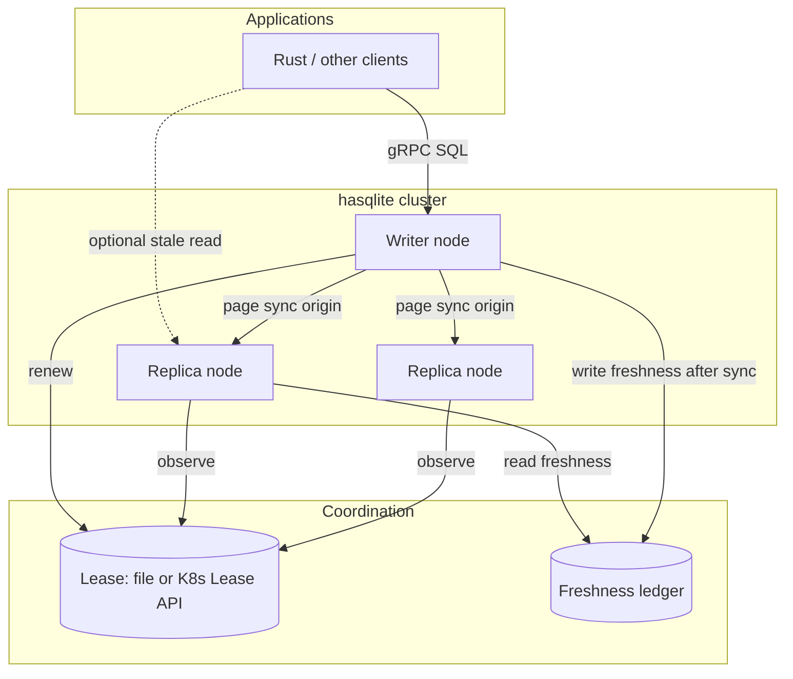

# hasqlite — Development & Test Plan

High Availability SQLite in Rust. This document is the implementation handoff:
architecture, phased delivery, crate layout, and a test matrix derived from
production patterns already proven in
[`rsqlite-rsync`](https://github.com/sria91/rsqlite-rsync).

---

## 1. Goals and future goals

### Goals

1. **Single logical writer** at all times, with **lease-backed fencing** and
   **generation monotonicity** (no split-brain writes).
2. **Fast failover** (target: low-second RTO) with **bounded RPO** via
   incremental rsync-style page sync from the current writer snapshot.
3. **Operator-grade** observability: audit log, readiness/liveness semantics,
   metrics, and Kubernetes-first deployment paths.
4. **Application API**: SQL over gRPC on the writer; safe redirect on replicas;
   Rust client with automatic `NOT_LEADER` failover (reuse
   `rsqlite-rsync-client` / shared protobuf).
5. **Library-first**: embed the HA controller in custom agents; ship a
   batteries-included `hasqlite` node binary.
6. **First-class standalone single-node Docker support (fast-track)**: Out-of-the-box
   capability to run a single `hasqlite` node in a standalone Docker container
   (file-based lease or auto-granted genesis lease, zero peer dependencies, gRPC SQL gateway,
   HTTP probes) for local development, edge, and single-host production before multi-node failover.

### Future goals (non-goals for v1)

- Multi-writer / distributed SQL consensus (Raft, Paxos, SQLite session
  extension).
- Cross-region active/active.
- Replacing rsqlite-rsync’s standalone sync CLI (keep compatibility; call sync
  as a library). Note: running `hasqlite` *itself* as a standalone single-node database
  service in Docker is explicitly a goal and fast-tracked (see §1.6 and §5 Phase 1b).
- Built-in TLS termination on the gateway (document mesh/proxy patterns instead).

### Success criteria (v1.0)

| Metric | Target |
|--------|--------|
| Split-brain write window | 0 (detected + fenced) |
| Steady-state sync interval | Configurable 1–5s default |
| Promotion block on stale replica | 100% when freshness age > threshold |
| Failover under synthetic load | RTO p95 < 15s on 3-node k3s (node-local disk) |
| Post-failover DB parity | Page-hash or checksum match vs writer pre-fail |

---

## 2. Learnings from rsqlite-rsync (carry forward)

### Proven building blocks

| Building block | Location in rsync | hasqlite action |
|----------------|-------------------|-----------------|
| Two-pass page hash sync (v2 BLAKE3) | `protocol`, `hash`, `transport` | Depend on `rsqlite-rsync` crate API (`sync_local`, gRPC transport) |
| Live origin, exclusive replica | `snapshot`, sync invariants | Document as hard cluster invariants in `safety-contract.md` |
| Lease record + KV text formats | `ha.rs`, `kv_text` | Extract/shared types in `hasqlite-lease` |
| Freshness ledger + promotion gates | `validate_promotion`, `enforce_write_fence` | Core of `hasqlite-controller` |
| File + Kubernetes lease readers | `FileLeaseReader`, `KubectlLeaseReader` | Pluggable `LeaseSource` trait |
| HA reconcile loop + audit | `HaController`, `HaRuntime` | Node supervisor in `hasqlite-node` |
| SQL Gateway + Replication gRPC | `gateway`, `rsqlite-rsync-proto` | Embed in writer role; proto crate as dependency |
| Client failover | `rsqlite-rsync-client` | First-class app integration story |
| K8s examples + runbooks | `docs/k3s-*`, `examples/k8s/` | Port to `deploy/k8s/` with hasqlite-specific naming |
| Integration test patterns | `ha_mode`, `grpc_failover`, `live_writes` | Mirror suite under `hasqlite/tests/` |

### Pain points to fix in hasqlite

1. **HA logic buried in a sync monolith** — harder to version, test, and embed.
2. **Operational split** — sync sidecar, lease updater, and `--ha` process are
   multiple moving parts in manifests; consolidate into one **node agent** with
   clear subtasks (lease, sync, gateway, probes).
3. **Readiness pitfalls** — `/ready` only passes on writer; document and encode
   StatefulSet rollout strategy in deploy templates (use `/healthz` for rollout).
4. **Auth vs fencing** — keep bearer auth mandatory by default; fencing is
   correctness, not authentication (same security model as rsync).

---

## 3. Architecture



### Layers

| Layer | Responsibility | Crate(s) |
|-------|----------------|----------|
| **Data plane** | SQLite files, WAL, gateway engine | `hasqlite-node` (+ rsync `db`/`gateway`) |
| **Replication** | Incremental sync scheduler, catch-up on promotion | `hasqlite-sync` (wraps `rsqlite-rsync`) |
| **Control** | Reconcile loop, promotion/demotion, write fence | `hasqlite-controller` |
| **Coordination** | Lease + freshness I/O | `hasqlite-lease` |
| **Wire / API** | Protobuf (shared), HTTP probes | `rsqlite-rsync-proto` (dep), `hasqlite-probes` |
| **Client** | App SDK | `rsqlite-rsync-client` (dep) or thin `hasqlite-client` re-export |

### Node roles and state machine

States: `Starting` → `Replica` | `Writer(g)` → `Demoting` → `Replica`.

Events per tick (from rsync `ReconcileDecision` model):

1. Observe lease (holder, generation, TTL, renewal timestamp).
2. Observe freshness (source node ID, source generation, sync timestamp, age).
3. Evaluate promotion eligibility:
   - If writer: check lease validity and renewal deadline.
   - If replica and lease expired/unheld: verify `validate_promotion` (freshness age ≤ `max_freshness_age_secs`, source generation ≥ `min_source_generation`, verified source node, clock skew within bounds).
4. Atomic lease acquisition with generation fencing:
   - When a replica is eligible to promote, it must NOT immediately assume the writer role.
   - The candidate replica MUST execute an atomic lease acquisition or compare-and-swap (CAS) operation on the authoritative lease store (e.g. Kubernetes Lease API `resourceVersion` CAS or file lock CAS).
   - CAS condition: the acquisition CAS cannot replace a lease renewed after the candidate's observation: compare a version that changes on renewal (e.g. Kubernetes Lease `resourceVersion` or monotonic renewal counter), or atomically recheck the holder and expiry under the file lock while asserting `expected_generation == observed_generation` and confirming the observed lease remains unheld/expired before atomically setting `holder = self`, `new_generation = observed_generation + 1`, and updated TTL.
   - If CAS succeeds: before entering `Promote`, re-validate freshness against the current time and confirm that this node still holds a valid lease for `new_generation`. If both checks pass, node advances to `Promote` with authoritative writer rights for `new_generation`. If either check fails, keep the node read-only as a replica (`StayReplica`) and release the lease only if it is still held by this node for that generation; otherwise let it expire.
   - If CAS fails (e.g. concurrent race won by another replica or renewal by writer): promotion is aborted immediately; node transitions to `StayReplica` (fail closed).
5. Decide: `KeepWriter`, `Promote`, `Demote`, `StayReplica`, `NoOp`.
6. Execute actions:
   - On `Promote` (strictly gated by CAS success): open writable handle, activate generation write fence, update role file to `writer:<gen>`, append audit, update probes (`/ready`).
   - On `Demote`: close/fence writable handles, abort in-flight writes, update role file to `replica`, update probes.
   - On `StayReplica`: trigger scheduled sync pull from current writer if due.

**Invariants** (tested continuously):

- At most one node reports `Writer` for a given lease epoch.
- Single-writer promotion guarantee: promotion strictly requires prior success of an atomic lease compare-and-swap (CAS) incrementing the generation counter; lost CAS races fail closed (`StayReplica`).
- Live-holder preservation: a renewal occurring between candidate observation and acquisition CAS prevents replacement of the live holder.
- No SQL write accepted unless `enforce_write_fence` passes for the current generation.
- Promotion rejected when `validate_promotion` fails (stale freshness, generation mismatch, unattributed freshness ledger).
- Replica DB not written except by sync engine (exclusive replica).

### Standalone single-node mode (Docker / edge / local)

While `hasqlite` is primarily an HA clustering engine, single-node standalone operation
is supported as an explicit first-class operational mode:

- **Direct genesis writer bootstrap**: In standalone mode (`mode = "standalone"` in `[node]` or CLI `--mode standalone`),
  the node skips peer freshness checks, acquires writer status via the authoritative file lease (`LeaseRecord`), and transitions
  directly from `Starting → Writer(g)`, bypassing the intermediate `Replica` state. Standalone configurations strictly require
  `lease.source = "file"`; Kubernetes lease backends are rejected because they do not provide single-node host filesystem mutual exclusion.
- **Generation continuity & authoritative source of truth**: The lease record (`LeaseRecord.generation` stored in the lease file)
  is the authoritative source of truth for writer identity and generation (per `docs/safety-contract.md` §2).
  - **First boot**: On a fresh volume with no prior lease file or database state, initial generation is explicitly `1`.
  - **Volume reuse**: When bootstrapping on an existing volume, the node reads the prior lease generation `g_lease`
    and database user metadata `g_db`, setting `g_prior = max(g_lease, g_db)`.
  - **Monotonic lease acquisition**: Standalone bootstrap writes an updated `LeaseRecord` with `generation = g_prior + 1`
    (or `1` if `g_prior == 0`) under advisory POSIX file locking (`flock`), guaranteeing generation monotonicity.
    When migrating the volume into an HA cluster, a fenced migration procedure seeds the new authoritative Kubernetes
    lease (e.g. lease metadata annotation/counter) with `g_prior` from the standalone file lease before any cluster CAS
    acquisition begins. This preserves the generation invariant in the safety contract (§2) so switching coordination
    backends cannot reset the generation or allow competing lease updates during transfer.
- **Mutual exclusion via canonical lock identity on shared volume**: Standalone configurations enforce exactly one
  canonical lock identity per database volume: `${data.dir}/.hasqlite.lease`. `ClusterConfig::validate()` strictly
  rejects configurations specifying any other `lease.file.path`. Allowing arbitrary paths on the volume would risk two
  containers configuring different file names (e.g. `lease.txt` vs `lock.file`), acquiring independent advisory locks on
  different inodes, and causing split-brain write corruption against the same database. By enforcing the single canonical
  path, every standalone container sharing the database volume contends for the exact same file inode via advisory POSIX
  file locking (`flock`/`fcntl`), ensuring any concurrent instance immediately fails fast with `EWOULDBLOCK`.
- **Zero-sync overhead**: Peer replication loops are dormant; write fence is active locally for writer generation `g`.
- **Graceful shutdown on `SIGTERM`**: Handles container stop signals within Docker's default 10s grace window through an
  ordered shutdown sequence:
  1. **Stop accepting requests**: Demote HTTP probe readiness (`/ready` returns 503) and reject incoming gRPC gateway calls
     with `UNAVAILABLE`.
  2. **Drain in-flight writes**: Drain active transactions and in-flight queries up to a bounded timeout (e.g., 5 seconds).
  3. **WAL checkpoint truncate**: Execute a blocking SQLite WAL checkpoint via `sqlite3_wal_checkpoint_v2(..., SQLITE_CHECKPOINT_TRUNCATE, ...)`
     to flush all committed database pages from the WAL into the primary database file and truncate the WAL file to zero bytes.
  4. **Deadline & fallback handling**: If `SQLITE_CHECKPOINT_TRUNCATE` cannot complete before the shutdown deadline (e.g., blocked
     by lingering reader locks or slow I/O, returning `SQLITE_BUSY`), the node logs a warning, falls back to a non-blocking passive
     checkpoint (`SQLITE_CHECKPOINT_PASSIVE`) without truncating, and cleanly proceeds with shutdown. SQLite WAL crash recovery will
     safely replay any remaining committed WAL frames on the next startup.
  5. **Release lease**: Release the advisory POSIX file lock (`flock`) and exit cleanly with status code 0.
- **Docker container runtime**: Designed to run inside standard Docker containers with a persistent
  volume mount at `/var/lib/hasqlite`, running under a configurable non-root user and group (defaulting to `hasqlite:hasqlite` with UID/GID `1000:1000` via build arguments `USER`/`GROUP`/`UID`/`GID`), using numeric `USER ${UID}:${GID}` (disallowing root `UID=0`) for compatibility with Kubernetes `runAsNonRoot: true` and OCI security policies, exposing:
  - gRPC SQL Gateway (`127.0.0.1:50051`) for read/write queries.
  - HTTP Probes (`:8088` `/ready`, `/live`, `/healthz`).
- **Seamless cluster upgrade path**: Upgrading from a standalone deployment to an HA cluster requires cleanly stopping
  and fencing the standalone writer before creating or acquiring writer authority under the new coordination backend
  (e.g., Kubernetes Lease API). Because the standalone file lock and Kubernetes Lease API are independent coordination
  mechanisms, running both concurrently without prior fencing would create a dual-writer split-brain hazard. The migration
  procedure requires: (1) terminate the standalone container and verify the POSIX lock is released, (2) inspect the standalone
  lease file to seed the initial generation `g_k8s = g_prior` on the Kubernetes Lease object, and (3) launch the HA cluster
  nodes under Kubernetes lease coordination where the first promote CAS will increment to `g_k8s + 1`.

---

## 4. Repository layout

```
hasqlite/
  Cargo.toml                 # workspace
  crates/
    hasqlite-core/           # shared types, config, errors
    hasqlite-lease/          # LeaseRecord, FreshnessLedger, sources
    hasqlite-controller/     # reconcile, plan, execute (pure logic)
    hasqlite-sync/           # scheduler, hooks, rsync integration
    hasqlite-probes/         # HTTP /ready, /live, /healthz
    hasqlite-node/           # runtime: tokio supervisor, gateway bind
  hasqlite/                  # binary CLI (package name hasqlite)
  deploy/
    docker/                  # Multi-stage Dockerfile, docker-compose.standalone.yml
    k8s/                     # StatefulSet, RBAC, lease, sync contract
  docs/
    PLAN.md                  # this file
    safety-contract.md
    runbooks/
  tests/
    integration/             # multi-process, filesystem lease
    chaos/                   # fault injection (feature-gated)
  benches/
```

### Dependency on rsqlite-rsync

Use a **path dependency** during development in `crates/hasqlite-sync/Cargo.toml`:

```toml
rsqlite-rsync = { path = "../../../rsqlite-rsync", default-features = false }
```

Published versions should pin to crates.io releases once HA APIs are stabilized
or split into `rsqlite-rsync-core`.

### Extraction strategy (from monolith)

| Phase | Action |
|-------|--------|
| E0 | hasqlite copies *interfaces*; calls rsync HA only via FFI to binary (avoid) |
| E1 | Re-export rsync `ha` types through thin wrappers; controller tests duplicated |
| E2 | Move `LeaseRecord`, promotion, reconcile **tests** here; impl stays in rsync |
| E3 | Extract `hasqlite-lease` + `hasqlite-controller` to this repo; rsync depends back for `--ha` shim |
| E4 | Single node binary; rsync remains sync-focused CLI |

Target for v1.0: **E2** (wrapper + comprehensive tests); v1.2: **E3**.

---

## 5. Development phases

### Phase 0 — Bootstrap (week 1)

- [x] Sibling repo + workspace skeleton
- [ ] CI: `cargo fmt`, `clippy -D warnings`, `cargo test`, `cargo doc`
- [ ] `hasqlite-core`: `NodeId`, `ClusterConfig`, error types
- [ ] Document safety contract

**Exit:** empty crates compile; PLAN approved.

### Phase 1 — Controller parity (weeks 2–4)

Port **pure logic** from `rsqlite-rsync/src/ha.rs` into `hasqlite-controller`:

- `parse_lease_record`, `parse_freshness_ledger` (with non-empty source node attribution)
- `validate_promotion`, `enforce_write_fence`
- Atomic lease acquisition / CAS trait: `LeaseSource::compare_and_swap_lease(expected_generation, expected_version, new_holder, new_generation) -> Result<LeaseRecord, LeaseCasError>` with generation and renewal fencing (compares version or rechecks expiry to prevent replacing a renewed lease)
- `HaController::tick` equivalent with injectable `LeaseSource` / `FreshnessSource`, strictly gating any promotion decision/action on atomic lease acquisition success
- `ControllerPlan` + `execute_controller_plan` with test doubles modeling concurrent promotion races where multiple replicas observe an expired lease simultaneously

Deliverables:

- 100% line coverage on promotion/fencing pure functions (see §6.1)
- Property tests for generation monotonicity, atomic CAS success/loss races, and TTL expiry
- Race test showing that a renewal between observation and acquisition prevents replacement of the live holder
- Single-winner verification: dual replica failover simulation asserting exactly one node promotes
- No SQLite I/O in this crate (fast CI)

### Phase 1b — Fast-track: Standalone single-node & Docker (weeks 3–4)

*Delivered early immediately following Phase 1 controller logic, unlocking a fully usable
standalone Docker container weeks ahead of multi-node replication and clustering.*

Scope:
- Multi-stage `Dockerfile` (optimized Rust musl/debian-slim build, configurable non-root user and group defaulting to `hasqlite:hasqlite` and UID/GID 1000:1000 via `ARG USER=hasqlite`, `ARG GROUP=hasqlite`, `ARG UID=1000`, and `ARG GID=1000` build arguments, persistent volume mount at `/var/lib/hasqlite`):
  - User and group provisioning executes strictly via POSIX `/bin/sh` (`groupadd`/`useradd`) to avoid collisions with shell built-ins such as bash's read-only `$UID`.
  - Disallows root builds (`UID=0` or `GID=0` validation check during build).
  - Configures numeric `USER ${UID}:${GID}` in the final image stage to guarantee compatibility with Kubernetes `runAsNonRoot: true` and OCI security scanners without relying on `/etc/passwd` lookups.
- `deploy/docker/docker-compose.standalone.yml` and container quickstart scripts with host volume permission guidance for default and custom user/group UID/GID execution.
- Standalone mode profile in `hasqlite-core` and `hasqlite-node`:
  - `mode = "standalone"` in `ClusterConfig` (or `--mode standalone` CLI / `HASQLITE_MODE=standalone`).
  - Pre-flight write check on `data.dir` during node startup, logging a clear diagnostic error with active UID/GID if the directory is unwritable (rather than surfacing raw SQLite I/O errors).
  - Auto-acquire genesis writer lease (POSIX `flock` on file lease) writing an authoritative `LeaseRecord` at `new_gen = g_prior + 1` (defaulting to `1` on first boot, or incrementing `max(g_lease, g_db)` observed from prior volume state) without requiring peer sync history or freshness section.
  - Secret file credential support: `auth_token_file` (or `HASQLITE_GRPC_AUTH_TOKEN_FILE`) for secure credential mounting via Docker secrets or volume files.
  - Minimal node supervisor: bind gRPC SQL gateway engine and HTTP probe server (`/ready`, `/live`, `/healthz`).
  - Graceful shutdown handling: synchronous `sqlite3_wal_checkpoint_v2(TRUNCATE)`, in-flight connection draining, and lease release within Docker's 10s grace window on `SIGTERM`/`SIGINT`.

Deliverables:
- Production `Dockerfile` with configurable non-root build arguments (`ARG USER=hasqlite`, `ARG GROUP=hasqlite`, `ARG UID=1000`, `ARG GID=1000`) and `deploy/docker/docker-compose.standalone.yml`.
- `hasqlite run --mode standalone` or `hasqlite run --config standalone.toml`.
- Standalone container smoke test in CI (`docker build` + boot container + execute SQL via gRPC + assert `/ready` 200 OK), verifying both default and custom username/groupname and UID/GID images (including negative testing for fast startup error on unwritable volumes), feature-gated with `--features=docker-tests`.

### Phase 2 — Sync orchestration (weeks 4–6)

`hasqlite-sync`:

- Policies: `Periodic`, `OnLeaseLost`, `PreShutdown`, `PostPromoteCatchUp`
- Wrap `rsqlite_rsync::sync_local` and gRPC pull/push
- Write freshness ledger on success (source node, generation, timestamp)
- Backoff / retry configuration aligned with rsync batch semantics

Deliverables:

- Integration tests: writer emits writes → replica converges within N syncs
- `live_writes` parity test (fork pattern from rsync)

### Phase 3 — HA cluster supervisor & local 3-node runtime (weeks 6–9)

`hasqlite-node` multi-process cluster runtime:

- Full HA cluster supervisor: background controller tick loop + sync worker task + dynamic gateway failover
- CLI flags mirroring rsync `--ha-*` for migration (deprecation table in docs)
- HTTP probes (`hasqlite-probes`) with Kubernetes readiness vs liveness semantics documented
- Graceful shutdown: preStop catchup sync, leader demote, drain gateway

Deliverables:

- Local 3-node simulation (three data dirs, shared lease file dir)
- Multi-node Docker Compose test harness (`deploy/docker/docker-compose.cluster.yml`)

### Phase 4 — Kubernetes opinionated deploy (weeks 9–11)

- Port `k3s-ha-stack.yaml` → `deploy/k8s/` with hasqlite image/command
- Lease updater sidecar contract **or** in-process K8s lease client (evaluate)
- Scripts: `apply-stack.sh`, manifest validator test (copy pattern from rsync)
- Runbook: failover, manual promotion, stale replica rebuild

Deliverables:

- k3d CI job (optional, nightly): smoke failover
- `docs/runbooks/failover.md`

### Phase 5 — Hardening & release (weeks 11–12)

- Metrics (Prometheus): sync lag, lease holder, promotion denials
- Soak test harness (24h, scheduled failovers)
- CHANGELOG, version 0.1.0, README quickstart

---

## 6. Test strategy

### 6.1 Unit tests (`hasqlite-controller`, `hasqlite-lease`)

| Area | Cases | Technique |
|------|-------|-----------|
| Lease parsing | empty, `none`, malformed, future renew | table-driven |
| K8s lease JSON | holder, generation annotation, missing fields | fixtures from rsync tests |
| Promotion | stale freshness, wrong generation, clock skew | pure function asserts |
| Write fence | non-writer, expired lease, generation mismatch | enum `PromotionViolation` |
| Reconcile | steal lease, renew, partition (stale holder) | state machine scenarios |
| CAS acquisition race | renewal between observation and acquisition | mock lease store (assert CAS fails, holder preserved) |
| Action execution | partial failure, continue-on-error | mock executor |

**Property-based** (proptest, mirror `property_tests.rs`):

- Generation never decreases on valid transitions
- TTL expiry eventually yields empty holder
- Freshness age monotonic with time injection

**Coverage target:** ≥95% on `hasqlite-controller` and `hasqlite-lease`.

### 6.2 Integration tests (`tests/integration/`)

| Test module | Purpose | rsync analogue |
|-------------|---------|----------------|
| `local_cluster.rs` | 3 nodes, file lease, promote/failover | `ha_mode.rs` |
| `sync_convergence.rs` | post-promote parity | `local_sync.rs` |
| `live_writes.rs` | writes during sync | `live_writes.rs` |
| `gateway_writer_only.rs` | NOT_LEADER on replica | `grpc_gateway.rs` |
| `client_failover.rs` | redirect + retry | `grpc_failover.rs` |
| `grpc_replication.rs` | native replication transport | `grpc_replication.rs` |
| `shutdown_sync.rs` | preStop catch-up | new |
| `readonly_replica_reads.rs` | `--allow-replica-reads` | gateway flags |
| `docker_standalone.rs` | Standalone single-node container boot (default and custom user/group & UID/GID), volume persistence, gRPC SQL CRUD, probe health | new (Phase 1b) |

Run: `cargo test --workspace` (default). Heavy cluster tests gated with
`--features=k8s-tests` or env `HASQLITE_K8S_TESTS=1`. Docker smoke tests gated with
`--features=docker-tests` or env `HASQLITE_DOCKER_TESTS=1` so standard `cargo test` passes
in container-less environments.

### 6.3 Fault injection (`tests/chaos/`, feature `chaos`)

| Scenario | Injection | Expected |
|----------|-----------|----------|
| Partition writer from lease store | block lease file writes / fake kubectl | demote, no writes |
| Stale replica promote | artificial old freshness | promotion denied |
| Sync transport failure | break gRPC / wrong token | retry, alert, no promote |
| Crash mid-write | SIGKILL writer | new writer after failover, bounded loss |
| Dual lease claim | corrupt lease file | single winner via generation rules |

### 6.4 Kubernetes / E2E

| Suite | Environment | Frequency |
|-------|-------------|-----------|
| Manifest validate | shell + kubeconform | every PR |
| k3d 3-node failover | CI nightly | nightly |
| Soak 24h + periodic kill | staging | pre-release |

Assertions:

- Exactly one lease holder in API
- At most one pod with writer-ready SQL accepting writes
- Row-count + page-hash spot checks after each failover

### 6.5 Performance & benchmarks

| Bench | Measures | Tool |
|-------|----------|------|
| `sync_catchup` | bytes moved vs churn | criterion (delegate to rsync benches) |
| `failover_rto` | promote → first successful write | custom harness |
| `controller_tick` | reconcile latency | criterion |

Re-use rsync env tuning: `RSQLITE_RSYNC_*` documented in hasqlite ops guide.

### 6.6 Security tests

- Gateway refuses unauthenticated start without explicit insecure flag
- Path traversal on `--data-dir` / database name
- Token required on all RPCs (client negative tests)

### 6.7 CI matrix

```yaml
# illustrative
jobs:
  fast:
    - cargo test -p hasqlite-controller -p hasqlite-lease
    - cargo test -p hasqlite-sync -- --test-threads=1
  integration:
    - cargo test --workspace
  lint:
    - cargo clippy --workspace --all-targets -- -D warnings
    - cargo fmt --check
  k8s:
    if: nightly
    - k3d cluster create && apply deploy/k8s && run smoke script
```

---

## 7. Configuration contract (v1)

Unified config file (TOML/YAML) replacing long flag lists:

```toml
[node]
id = "pod-0"

[data]
dir = "/var/lib/hasqlite"

[lease]
source = "kubernetes" # or "file"

# If lease.source = "file":
# [lease.file]
# path = "/var/run/lease.txt"

# If lease.source = "kubernetes":
[lease.kubernetes]
lease_name = "hasqlite-writer"
namespace = "default"

[freshness]
path = "/var/run/freshness.txt"
max_age_secs = 10

[promotion]
min_source_generation = 0
max_future_skew_secs = 2

[sync]
interval_secs = 2
origin_endpoint = "grpc://writer:50051" # role-dependent
transport_auth_token_env = "HASQLITE_GRPC_AUTH_TOKEN"

[gateway]
bind = "0.0.0.0:50051"
auth_token_env = "HASQLITE_GRPC_AUTH_TOKEN"
# auth_token_file = "/run/secrets/hasqlite_token"
allow_replica_reads = false

[probes]
http_bind = "0.0.0.0:8088"
```

CLI: `hasqlite run --config cluster.toml` plus env overrides.

### Standalone single-node profile (Docker / edge)

For running a single standalone node in Docker without replication peers:

```toml
[node]
id = "standalone-0"
mode = "standalone" # Auto-promotes to genesis writer at generation g_prior + 1 (1 on first boot)

[data]
dir = "/var/lib/hasqlite"

[lease]
source = "file" # Standalone mode strictly requires file-backed lease

[lease.file]
# Standalone mode enforces this exact canonical path within data.dir to guarantee mutual exclusion
path = "/var/lib/hasqlite/.hasqlite.lease"

# Note: [freshness], [promotion], and [sync] sections are omitted in standalone mode

[gateway]
bind = "0.0.0.0:50051"
auth_token_file = "/run/secrets/hasqlite_token" # Mutually exclusive with auth_token_env
# auth_token_env = "HASQLITE_GRPC_AUTH_TOKEN"
allow_replica_reads = false

[probes]
http_bind = "0.0.0.0:8088"
```

### Standalone Docker invocation

> [!NOTE]
> **Phase 1b Target**: The Docker invocation below illustrates the planned deployment workflow once the Phase 1b runtime and packaging land. (In the current Phase 0 repository, the binary outputs a bootstrap log and exits).
>
> All required configuration fields (`node.id`, `data.dir`, `lease.source`, `gateway.bind`, `probes.http_bind`) are supplied by mounting the standalone TOML configuration. In Phase 1b, the image entrypoint will also support synthesizing minimal standalone defaults if config mounts are omitted.
>
> **Configurable Non-Root User & Volume Permissions**: The image defaults to non-root user and group `hasqlite:hasqlite` with UID:GID `1000:1000`. Custom user/group names and UID/GID values can be configured at build time using `--build-arg USER=<user> --build-arg GROUP=<group> --build-arg UID=<uid> --build-arg GID=<gid>`. Note that build arguments configure the image's internal user identity and default directory permissions, but do not change ownership or permissions on host bind mounts. When mounting a host directory to `/var/lib/hasqlite`, users must ensure the host directory grants write access to the runtime UID/GID (e.g., `chown -R <uid>:<gid> /path/to/host/data` or `chmod 0770`). The image configures numeric `USER ${UID}:${GID}` so runtime `-u` flags are unnecessary unless explicitly overriding the container user at runtime.
>
> **Secret File Permissions**: When using `auth_token_file` with mounted secrets (e.g. `/run/secrets/hasqlite_token`), ensure the secret file is readable by the configured non-root UID/GID without exposing credentials to other local users. Recommend file mode `0400` (read-only by runtime UID) or `0440` (read-only by runtime UID and restricted group); do not use world-readable permissions (`0444`).
>
> **Plaintext Gateway & Network Security**: The gRPC SQL Gateway communicates in plaintext in v1 and does not provide built-in TLS termination. The host port mapping binds strictly to host loopback (`127.0.0.1:50051:50051`) to avoid publishing the unencrypted gateway on public interfaces. Any remote or multi-host access MUST traverse an external TLS termination reverse proxy or ingress sidecar (such as Envoy, Traefik, or Nginx).

```bash
# Optional: build with custom non-root user/group and UID/GID (defaults to hasqlite:hasqlite and 1000:1000 if omitted)
# docker build \
#   --build-arg USER=customuser \
#   --build-arg GROUP=customgroup \
#   --build-arg UID=1001 \
#   --build-arg GID=1001 \
#   -t hasqlite:${HASQLITE_VERSION:-0.1.0} \
#   -f deploy/docker/Dockerfile .

docker run -d \
  --name hasqlite \
  -p 127.0.0.1:50051:50051 \
  -p 8088:8088 \
  -v /path/to/standalone.toml:/etc/hasqlite/cluster.toml:ro \
  -v hasqlite-data:/var/lib/hasqlite \
  -v /path/to/token.txt:/run/secrets/hasqlite_token:ro \
  hasqlite:${HASQLITE_VERSION:-0.1.0} \
  run --config /etc/hasqlite/cluster.toml
```

---

## 8. Observability

| Signal | Format |
|--------|--------|
| Audit log | append-only JSON lines (action, from, to, lease gen) |
| Role state file | `replica` / `writer:<gen>` |
| Metrics | Prometheus: `hasqlite_sync_lag_seconds`, `hasqlite_lease_held`, `hasqlite_promotion_denied_total` |
| Tracing | `tracing` spans: `tick`, `sync`, `promote` |

Alerts (recommended):

- `sync_lag > freshness max_age` for > 2 intervals
- promotion denied spike
- lease holder missing > TTL

---

## 9. Risks and mitigations

| Risk | Mitigation |
|------|------------|
| Stale replica promoted | Freshness gate + default deny; manual recovery runbook |
| Dual writer during partition | Lease TTL + demote on lease loss + gateway write fence |
| Large catch-up after failover | PreStop sync + post-promote immediate sync; monitor lag |
| API drift with rsync | Shared proto crate; contract tests in CI |
| StatefulSet rollout stall | Document `/healthz` vs `/ready`; chart defaults |

---

## 10. Milestone checklist (summary)

| Milestone | Deliverable | Tests |
|-----------|-------------|-------|
| M0 | Workspace + PLAN | CI green on empty crates |
| M1 | Controller parity | unit + proptest |
| M1.5 (Fast-track) | Standalone Single-Node Docker | Multi-stage Dockerfile, standalone writer gateway, probes |
| M2 | Sync worker | integration convergence |
| M3 | HA cluster runtime | 3-node local HA |
| M4 | K8s deploy | manifest + k3d smoke |
| M5 | 0.1.0 release | soak + security suite |

---

## 11. References

- [rsqlite-rsync README](https://github.com/sria91/rsqlite-rsync/blob/master/README.md)
- [rsqlite-rsync HA guide](https://github.com/sria91/rsqlite-rsync/blob/master/docs/ha-guide.md)
- [k3s HA runbook](https://github.com/sria91/rsqlite-rsync/blob/master/docs/k3s-ha-runbook.md)
- [Protocol](https://github.com/sria91/rsqlite-rsync/blob/master/docs/protocol.md)
- [plan-k3sHaSqliteSync.prompt.md](https://github.com/sria91/rsqlite-rsync/blob/master/.github/prompts/plan-k3sHaSqliteSync.prompt.md)
