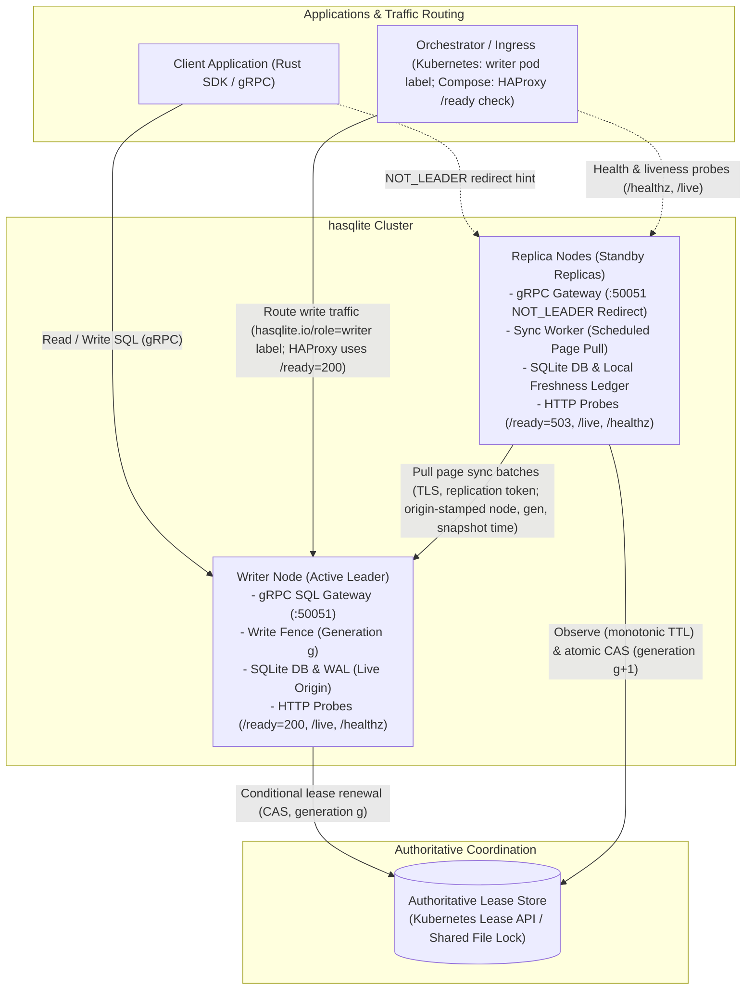
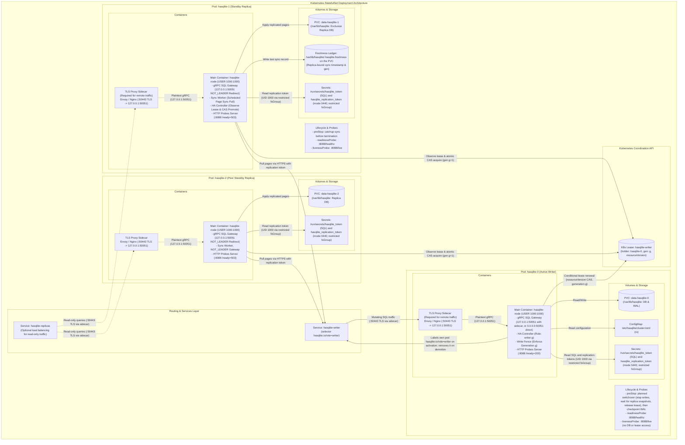
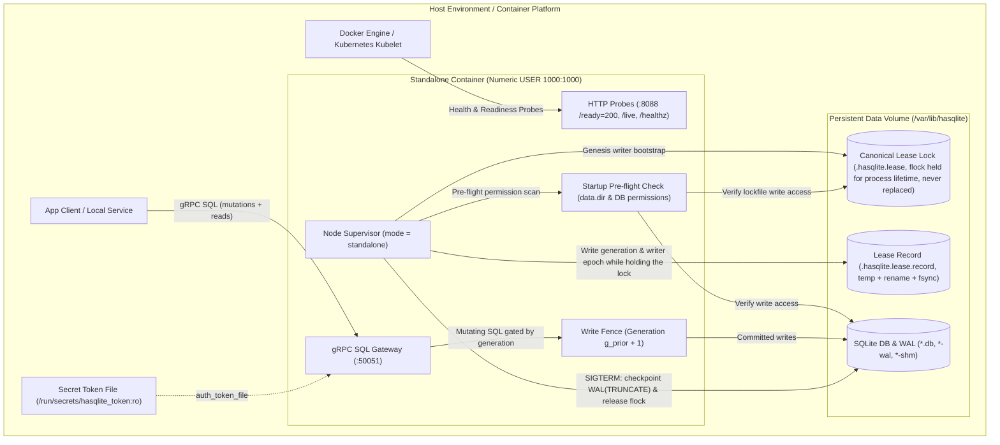

# hasqlite — Architecture

## 2. Prior art from rsqlite-rsync (carry forward concepts)

### Proven building blocks

| Building block | Location in rsync | hasqlite action |
|----------------|-------------------|-----------------|
| Two-pass page hash sync (v2 BLAKE3) | `protocol`, `hash`, `transport` | Use the current crate integration as a bridge; implement and test the required behavior natively before removing it |
| Live origin, exclusive replica | `snapshot`, sync invariants | Document as hard cluster invariants in `safety-contract.md` |
| Lease record + KV text formats | `ha.rs`, `kv_text` | Extract/shared types in `hasqlite-lease` |
| Freshness ledger + promotion gates | `validate_promotion`, `enforce_write_fence` | Core of `hasqlite-controller` |
| File + Kubernetes lease readers | `FileLeaseReader`, `KubectlLeaseReader` | Pluggable `LeaseSource` trait |
| HA reconcile loop + audit | `HaController`, `HaRuntime` | Node supervisor in `hasqlite-node` |
| SQL Gateway + Replication gRPC | `gateway`, protobuf API | Implement in the hasqlite node and own the protocol definitions |
| Client failover | Existing client API | Provide a native `hasqlite-client` with first-class failover |
| K8s examples + runbooks | `docs/k3s-*`, `examples/k8s/` | Port to `deploy/k8s/` with hasqlite-specific naming |
| Integration test patterns | `ha_mode`, `grpc_failover`, `live_writes` | Mirror suite under `hasqlite/tests/` |

### Pain points to fix in hasqlite

1. **HA logic buried in a sync monolith** — harder to version, test, and embed.
2. **Operational split** — sync sidecar, lease updater, and `--ha` process are
   multiple moving parts in manifests; consolidate into one **node agent** with
   clear subtasks (lease, sync, gateway, probes).
3. **Readiness pitfalls** — `/ready` only passes on writer; document and encode
   StatefulSet rollout strategy in deploy templates (use `/healthz` for rollout,
   writer pod label for routing).
4. **Auth vs fencing** — keep bearer auth mandatory by default; fencing is
   correctness, not authentication. SQL and replication use separate credentials.

---

## 3. Architecture

### Simplified architecture block diagram



### Detailed cluster interaction topology

```mermaid
flowchart TB
  subgraph apps ["Applications & Traffic Routing"]
    APP["Client Application (Rust SDK / gRPC)"]
    ROUTER["Orchestrator / Ingress / Proxy (K8s Service / Envoy)"]
  end

  subgraph cluster ["hasqlite HA Cluster"]
    subgraph writer ["Writer Node (Active Leader)"]
      W_GW["gRPC SQL Gateway (:50051)"]
      W_FENCE["Write Fence (Generation g)"]
      W_DB[("SQLite DB & WAL (Live Origin)")]
      W_CTRL["HA Controller (Role: writer:g)"]
      W_PROBE["HTTP Probes (:8088 /ready=200, /live, /healthz)"]
    end

    subgraph r1 ["Replica Node 1 (Candidate / Standby)"]
      R1_GW["gRPC SQL Gateway (:50051)"]
      R1_SYNC["Sync Worker (Scheduled Pull)"]
      R1_DB[("SQLite DB (Exclusive Replica Target)")]
      R1_LEDGER[("Freshness Ledger (Replica-Bound Storage)")]
      R1_CTRL["HA Controller (Promotion Gate & CAS)"]
      R1_PROBE["HTTP Probes (:8088 /ready=503, /live, /healthz)"]
    end

    subgraph r2 ["Replica Node 2 (Peer Standby)"]
      R2_GW["gRPC SQL Gateway (:50051)"]
      R2_SYNC["Sync Worker (Scheduled Pull)"]
      R2_DB[("SQLite DB (Exclusive Replica Target)")]
      R2_LEDGER[("Freshness Ledger (Replica-Bound Storage)")]
      R2_CTRL["HA Controller (Standby Reconcile)"]
      R2_PROBE["HTTP Probes (:8088 /ready=503, /live, /healthz)"]
    end
  end

  subgraph coord ["Authoritative Coordination"]
    LS[("Authoritative Lease Store (K8s Lease API / Shared File Lock)")]
  end

  APP -->|"Read/Write SQL (gRPC)"| W_GW
  APP -.->|"Mutating SQL rejected (NOT_LEADER + redirect hint)"| R1_GW
  APP -.->|"Optional stale read (if allow_replica_reads=true)"| R1_GW
  R1_GW -.->|"Automatic client failover to new writer"| APP

  ROUTER -->|"Route write traffic (writer pod label; HAProxy health-checks /ready=200)"| W_PROBE
  ROUTER -.->|"Not routed for writes (no writer label; /ready=503)"| R1_PROBE
  ROUTER -.->|"Pod lifecycle & rolling update (/healthz, /live)"| R1_PROBE
  ROUTER -.->|"Pod lifecycle & rolling update (/healthz, /live)"| R2_PROBE

  W_GW -->|"Mutating SQL gated by generation g"| W_FENCE
  W_FENCE -->|"Committed writes"| W_DB
  W_CTRL -->|"Supervises active role"| W_GW
  W_CTRL -->|"Sets probe readiness (/ready=200)"| W_PROBE
  W_CTRL -->|"Conditional lease renewal (CAS, generation g); stop commits at renew deadline"| LS

  R1_SYNC -->|"Pull page sync batches (TLS for remote origins)"| W_DB
  R1_SYNC -->|"Apply consistent snapshot"| R1_DB
  R1_SYNC -->|"Invalidate, apply, fsync, then record origin-stamped synced_at_secs, source node & gen"| R1_LEDGER

  R2_SYNC -->|"Pull page sync batches (TLS for remote origins)"| W_DB
  R2_SYNC -->|"Apply consistent snapshot"| R2_DB
  R2_SYNC -->|"Invalidate, apply, fsync, then record origin-stamped synced_at_secs, source node & gen"| R2_LEDGER

  R1_CTRL -->|"Observe lease (holder, gen, TTL)"| LS
  R1_CTRL -->|"validate_promotion() (writer epoch, lag vs writer renewal, binding, skew)"| R1_LEDGER
  R1_CTRL ==>|"On lease expiry (version unchanged for TTL, local monotonic clock): CAS acquire (g to g+1), then CAS activate"| LS
  R1_CTRL -.->|"On activation: open DB, set /ready=200"| R1_DB

  R2_CTRL -->|"Observe lease (holder, gen, TTL)"| LS
  R2_CTRL -->|"validate_promotion() (writer epoch, lag vs writer renewal, binding, skew)"| R2_LEDGER
  R2_CTRL -.->|"Lost CAS race fails closed (StayReplica)"| LS
```



### Kubernetes pod and container deployment architecture



> **Operational model and security defaults**:
>
> - **Single node agent, no lease-sidecar split**:
>   `hasqlite-node` owns the lease client, controller loop, sync worker, SQL gateway,
>   and probe server in the same process. A separate lease-holding sidecar is out
>   of scope for v1 because it would allow a healthy sidecar to outlive a wedged
>   writer process and hide the real failure mode. This keeps the lease holder and
>   the current writer process aligned, which is required for safe failover.
>
> - **Remote traffic is protected by TLS before it reaches the gateway**:
>   The gRPC SQL gateway does not provide built-in TLS termination. Remote
>   replication and gateway traffic MUST use a TLS-terminating sidecar or ingress
>   (for example, on `:50443`). Plaintext `grpc://` endpoints are allowed only for
>   loopback or local-only standalone deployments; `gateway.allow_unauthenticated`
>   is rejected in clustered mode because the sidecar forwards remote traffic to a
>   loopback listener. Internal certificates come from a private CA and therefore
>   require `sync.tls_ca_file` in the native transport path; the adapter remains
>   public-WebPKI only until the native backend is deployed.
>
> - **Auth is not a replacement for fencing**:
>   Auth tokens protect the boundary, but the correctness model still depends on
>   lease generation, freshness validation, and the write fence before `COMMIT`.
>   SQL and replication credentials remain separate; the replication bearer token
>   is never accepted by the SQL gateway and vice versa.
>
> - **Readiness and liveness are different guards**:
>   `readinessProbe` checks `/healthz` and reports service readiness. `livenessProbe`
>   checks `/live` and reports only that the controller loop is alive; it must not
>   access SQLite or the lease store. Replica `preStop` hooks attempt a final
>   catch-up sync. The writer `preStop` hook performs a planned switchover,
>   drains writes, waits for a bounded final sync, releases the lease, and then
>   checkpoints. `terminationGracePeriodSeconds` MUST cover drain, final sync, and
>   checkpoint. A PodDisruptionBudget (`maxUnavailable: 1`) and a replica-first
>   rollout keep each planned switchover to one writer transition.
>
> - **Routing is best-effort, safety is enforced by fencing**:
>   A standard Service is not writer-aware, so the node reconciles the
>   `hasqlite.io/role=writer` pod label on startup against its current role
>   (removing it when starting as a replica and ensuring it is present when
>   starting as writer), applies it on activation, and removes it on demotion.
>   Failed label updates are retried with backoff so stale labels cannot persist
>   unnoticed. The writer Service selects that label, but the label can lag the
>   lease. Routing therefore helps traffic flow; the correctness guard remains
>   the lease and the pre-commit write fence.

### Layers

| Layer | Responsibility | Crate(s) |
|-------|----------------|----------|
| **Data plane** | SQLite files, WAL, hardened SQL gateway engine | `hasqlite-gateway`, `hasqlite-node` |
| **Replication** | Incremental sync scheduler, catch-up on promotion | `hasqlite-sync` (currently integrates `rsqlite-rsync`; native backend is the target) |
| **Control** | Reconcile loop, promotion/demotion, write fence | `hasqlite-controller` |
| **Coordination** | Lease + freshness I/O | `hasqlite-lease` |
| **Wire / API** | Protobuf API, HTTP probes | `hasqlite-proto` (Phase 1a), `hasqlite-probes` |
| **Client** | App SDK | `hasqlite-client` |

### Node roles and state machine

States: `Starting` → `Replica` | `Writer(g)` → `Demoting` → `Replica`.

Events per tick (informed by the upstream `ReconcileDecision` model):

1. Observe lease (holder, generation, version, activated writer epoch, holder's
   `ttl_secs`). Candidates feed the hasqlite-owned version token (not the backend's
   native revision, see contract rule 2) into a `LeaseObservation`, which measures
   expiry with the local monotonic clock against the effective TTL
   `max(local ttl_secs, observed ttl_secs)` (rule 4); they never compare the
   holder's `renewed_at_secs` with their own wall clock.
2. Observe freshness ledger (source node ID, source generation, origin-stamped
   snapshot start, destination node ID).
3. Evaluate:
   - If writer: renew (step 4). Commits are allowed only before the renewal
     deadline (see *Lease timing and write fencing*).
   - If replica and the lease is released, or its version has been unchanged for
     the effective TTL on the local monotonic clock: run `validate_promotion`
     against the observed lease. The ledger must be bound to this node, come from
     the lease's activated writer epoch (same node and generation), lag that
     writer's last renewal by at most `freshness.max_lag_secs`, and not be stamped
     more than `max_future_skew_secs` in the future. Both lag timestamps come from
     the writer's clock, so detection delay and cross-node skew do not affect the
     result. A whole-cluster cold restart can therefore promote an eligible
     replica without operator action when coordination is available; the
     acquisition delay below favors, but does not guarantee, the freshest one.
   - Freshest replica first: an eligible candidate waits
     `retry_period_secs × lag_secs / max_lag_secs` before its acquisition attempt
     and aborts if the lease version changes meanwhile, so the least-lagged
     replica normally wins the race. Because lag uses saturating subtraction
     (`writer.renewed_at_secs.saturating_sub(synced_at_secs)`), multiple snapshots
     taken at or after the writer's last renewal evaluate to zero lag and zero delay;
     among such candidates, an older snapshot may win the race without a freshness
     preference.
   - From the moment it decides to campaign until it promotes or stays a
     replica, the candidate pauses scheduled sync, so its validated ledger cannot
     change.
4. Lease writes are the compare-and-swap operations *acquire*, *activate*, *renew*
   and *release* defined normatively in [safety contract rule 6](safety-contract.md#lease-timing-and-write-fencing)
   (this document does not restate them). Each write bumps the hasqlite-owned
   version token and uses the backend's native revision as the CAS precondition.
   Every timestamp the writer stamps comes from its `WriterClock` (rule 4).
   Operational consequences:
   - A lost acquire means `StayReplica`. A conflict on activate, renew or
     release means immediate `Demote`; a writer never overwrites a newer holder.
   - No second freshness check after a won CAS: validation inputs are frozen
     while campaigning. Before opening the writable handle the node only
     confirms that activation succeeded and its renewal deadline has not passed.
   - An acquired but never-activated generation (winner crashed or lost the
     lease) leaves the previous writer epoch in place, so peers synced from that
     writer stay promotable. A writer that activates and then dies before any
     replica syncs from it blocks automatic promotion (fail closed; see the
     manual promotion runbook).
5. Decide: `KeepWriter`, `Promote`, `Demote`, `StayReplica`, `NoOp`.
6. Execute actions:
   - On `Promote` (strictly gated by acquire and activate success): open the
     writable handle on the validated snapshot (no catch-up in v1, contract rule
     13), activate generation write fence, update
     role file to `writer:<gen>`, label the pod, append audit, update probes
     (`/ready`). The sync engine refuses to run once the role is `Writer`.
   - On `Demote`: `sqlite3_interrupt` in-flight statements, close writable
     handles, remove the pod label, update role file to `replica`, update probes.
     Before the first resync, preserve the database as `*.diverged-g<gen>`.
   - On `StayReplica`: trigger scheduled sync pull from current writer if due.

### Lease timing and write fencing

| Setting | Default | Meaning |
|---------|---------|---------|
| `lease.ttl_secs` | 10 | Candidates treat the lease as expired after its version is unchanged for `max(this, holder's recorded ttl_secs)` (local monotonic clock) |
| `lease.renew_deadline_secs` | 6 | The writer stops accepting commits this long after *sending* its last successful renewal |
| `lease.retry_period_secs` | 2 | Interval between renewal and acquisition attempts; at most half the renewal deadline so one failed attempt does not demote |

A candidate can only see a renewal after the writer sent it, so the writer's
deadline always falls before any candidate's TTL can elapse.
`ttl_secs − renew_deadline_secs` is the fencing margin (validated ≥ 2s). It
absorbs commit latency and process stalls. `enforce_write_fence` runs inside the
write transaction immediately before `COMMIT`, and the controller calls
`sqlite3_interrupt` at the deadline. Each node writes its own disk and nothing
at the storage layer rejects stale generations, so a stall *inside* a commit
longer than the margin can still produce a commit after a peer has promoted.
This residual risk is stated in the safety contract and exercised by the
pause-injection chaos tests.

**Invariants** (tested continuously):

- At any instant at most one node accepts commits, across all generations (subject to the fencing margin above).
- Single-writer promotion guarantee: promotion strictly requires prior success of an atomic acquire CAS incrementing the generation counter, followed by a successful activate CAS; lost CAS races fail closed (`StayReplica`).
- Live-holder preservation: a renewal occurring between candidate observation and acquisition CAS prevents replacement of the live holder, and a renewal by a superseded writer fails instead of overwriting the new holder.
- No commit after the writer's renewal deadline; no SQL write accepted unless `enforce_write_fence` passes for the current generation.
- Promotion rejected when `validate_promotion` fails (lag, writer-epoch mismatch, unbound or self-sourced ledger, future timestamp).
- Replica DB not written except by sync engine (exclusive replica); writer DB never written by the sync engine.

### Standalone single-node mode (Docker / edge / local)

While `hasqlite` is primarily an HA clustering engine, single-node standalone operation
is supported as an explicit first-class operational mode:



- **Direct genesis writer bootstrap**: In standalone mode (`mode = "standalone"` in `[node]` or CLI `--mode standalone`),
  the node skips peer freshness checks, acquires writer status via the authoritative file lease (`LeaseRecord`), and transitions
  directly from `Starting → Writer(g)`, bypassing the intermediate `Replica` state. Standalone configurations strictly require
  `lease.source = "file"`; Kubernetes lease backends are rejected because they do not provide single-node host filesystem mutual exclusion.
- **Generation continuity & authoritative source of truth**: The lease record (`LeaseRecord` stored in
  `${data.dir}/.hasqlite.lease.record`) is the *only* source of truth for writer identity and generation
  (per `docs/safety-contract.md` rule 2). hasqlite never stores its generation in `PRAGMA user_version`, which
  application migration tools own, and keeps no secondary metadata file.
  - **First boot**: On a fresh volume with neither a lease record nor database files, the initial generation is `1`.
  - **Volume reuse**: When bootstrapping on an existing volume, the node reads the prior generation `g_prior` from the
    lease record and writes `generation = g_prior + 1`.
  - **Fail closed on lost history**: If database files exist but the lease record is missing or unparseable, the node
    refuses to start, because bootstrapping at generation 1 would silently reset the generation history
    (contract rule 3, [§10.6](operations.md#106-unresolved-guarantees-and-recovery-policy)). The operator supplies
    the generation explicitly (`hasqlite genesis --generation <g>`), which is audited.
  - **Monotonic lease acquisition**: Standalone bootstrap writes the updated `LeaseRecord` and an activated writer
    epoch for itself while holding the lock, guaranteeing generation monotonicity.
    When migrating the volume into an HA cluster, a fenced migration procedure seeds the new authoritative Kubernetes
    lease (e.g. lease metadata annotation/counter) with `g_prior` from the standalone file lease before any cluster CAS
    acquisition begins. This preserves the generation invariant in the safety contract (rule 3) so switching coordination
    backends cannot reset the generation or allow competing lease updates during transfer.
- **Mutual exclusion via canonical lock identity on shared volume**: Standalone configurations enforce exactly one
  canonical lock identity per database volume: `${data.dir}/.hasqlite.lease`. `ClusterConfig::validate()` strictly
  rejects configurations specifying any other `lease.file.path`. Allowing arbitrary paths on the volume would risk two
  containers configuring different file names (e.g. `lease.txt` vs `lock.file`), acquiring independent advisory locks on
  different inodes, and causing split-brain write corruption against the same database. By enforcing the single canonical
  path, every standalone container sharing the database volume contends for the exact same file inode, ensuring any
  concurrent instance immediately fails fast with `EWOULDBLOCK`. The lock rules that keep this true:
  - The lock file `.hasqlite.lease` is **never replaced, renamed or deleted**. An atomic write-temp-then-rename would
    leave the holder locking an unlinked inode while a second container locks the new one. The record lives in a
    separate file, `.hasqlite.lease.record`, written by temp file + rename + directory fsync while the lock is held.
  - The lock is taken with `flock(LOCK_EX | LOCK_NB)` (or open-file-description locks). Process-associated `fcntl`
    locks are never used, because closing *any* descriptor on the file releases them. `flock` and `fcntl` locks do
    not exclude each other, so the two are never mixed.
  - **Two lock disciplines, one file.** `FileLeaseSource` has two modes that must never be mixed on one volume:
    - *Standalone (mutex mode)*: the descriptor is held for the process lifetime, so a second container on the
      same volume fails fast with `EWOULDBLOCK`. The record is rewritten under that lock.
    - *Clustered local file lease (CAS mode, single host, test and Compose harnesses only)*: every node takes the
      lock only for the duration of one read-compare-write of the record (`flock(LOCK_EX)` blocking with a bounded
      wait), then releases it; the record's write counter is the hasqlite version token and the CAS precondition at
      once. Holding the lock across the whole process lifetime here would prevent peers from ever acquiring.
    The mode is selected by `node.mode`; a mutex-mode holder makes CAS-mode peers fail with `EWOULDBLOCK` rather
    than wait, which surfaces the misconfiguration immediately.
  - The pre-flight check calls `statfs` on `data.dir` and refuses NFS, CIFS/SMB and FUSE filesystems, where neither
    advisory locks nor SQLite locking are reliable across hosts. Standalone mode therefore requires a local filesystem.
- **Zero-sync overhead**: Peer replication loops are dormant; write fence is active locally for writer generation `g`.
- **Graceful shutdown on `SIGTERM`**: Handles container stop signals within Docker's default 10s grace window through an
  ordered shutdown sequence:
  1. **Stop accepting requests**: Demote HTTP probe readiness (`/ready` returns 503) and reject incoming gRPC gateway calls
     with `UNAVAILABLE`.
  2. **Drain in-flight writes**: Drain active transactions and in-flight queries up to a bounded timeout (e.g., 5 seconds).
  3. **WAL checkpoint truncate**: Execute a blocking SQLite WAL checkpoint via `sqlite3_wal_checkpoint_v2(..., SQLITE_CHECKPOINT_TRUNCATE, ...)`
     to flush all committed database pages from the WAL into the primary database file and truncate the WAL file to zero bytes.
  4. **Deadline & fallback handling**: If `SQLITE_CHECKPOINT_TRUNCATE` cannot complete before the shutdown deadline (e.g., blocked
     by lingering reader locks or slow I/O, returning `SQLITE_BUSY`), the node logs a warning, falls back to a non-blocking passive
     checkpoint (`SQLITE_CHECKPOINT_PASSIVE`) without truncating, and cleanly proceeds with shutdown. SQLite WAL crash recovery will
     safely replay any remaining committed WAL frames on the next startup.
  5. **Release lease**: Release the advisory POSIX file lock (`flock`) and exit cleanly with status code 0.

  The binary runs as PID 1 in the container, where the kernel installs no default `SIGTERM`/`SIGINT` handling, so the
  node installs explicit handlers (`tokio::signal`) rather than relying on an init shim.
- **Docker container runtime**: Designed to run inside standard Docker containers with a persistent volume mount at
  `/var/lib/hasqlite` under a configurable non-root numeric `USER`, exposing the gRPC SQL gateway (`:50051`) and HTTP
  probes (`:8088`), both published on host loopback only. Image build arguments, UID/GID and host-volume permission
  guidance live in one place: [configuration.md](configuration.md#standalone-docker-invocation).
- **Seamless cluster upgrade path**: Upgrading from a standalone deployment to an HA cluster requires cleanly stopping
  and fencing the standalone writer before creating or acquiring writer authority under the new coordination backend
  (e.g., Kubernetes Lease API). Because the standalone file lock and Kubernetes Lease API are independent coordination
  mechanisms, running both concurrently without prior fencing would create a dual-writer split-brain hazard. The migration
  procedure requires: (1) terminate the standalone container and verify the POSIX lock is released, (2) inspect the standalone
  lease record to seed the initial generation `g_k8s = g_prior` and the activated writer epoch on the Kubernetes Lease
  object, and (3) launch the HA cluster nodes under Kubernetes lease coordination. The first node is seeded through the
  genesis procedure from the standalone database; the others join as replicas and sync before they are eligible to
  promote.

---

## 4. Repository layout

```
hasqlite/
  Cargo.toml                 # workspace
  crates/
    hasqlite-core/           # shared types, config, errors
    hasqlite-lease/          # LeaseRecord, FreshnessLedger, sources
    hasqlite-controller/     # reconcile, plan, execute (pure logic)
    hasqlite-sync/           # scheduler, hooks, transitional replication adapter
    hasqlite-probes/         # HTTP /ready, /live, /healthz
    hasqlite-proto/          # wire API: SQL gateway + replication services (Phase 1a; placeholder crate today)
    hasqlite-gateway/        # hardened SQL engine: classification, authorizer, limits (Phase 1b; placeholder crate today)
    hasqlite-client/         # Rust client with NOT_LEADER failover (placeholder crate today)
    hasqlite-node/           # runtime: tokio supervisor, gateway bind
  hasqlite/                  # binary CLI (package name hasqlite)
  deploy/                    # (planned, Phase 1b/4)
    docker/                  # Multi-stage Dockerfile, docker-compose.standalone.yml
    k8s/                     # StatefulSet, RBAC, lease, sync contract
  docs/
    PLAN.md                  # entry point: goals, glossary, milestones; sections are numbered globally across docs/
    safety-contract.md
    runbooks/                # (planned, Phase 4)
  tests/                     # (planned)
    sim/                     # deterministic simulation (Phase 1)
    integration/             # multi-process, filesystem lease
    chaos/                   # fault injection (feature-gated)
  benches/                   # (planned, Phase 5)
```

All planned crates are registered in the workspace from day one (as doc-only placeholders) so the lint,
docstring, test and coverage gates apply to their first line of real code.

### Dependency-removal plan

`hasqlite-sync` currently uses the `rsqlite-rsync` v0.5.0 Git dependency, pinned
by commit `rev` rather than the movable tag, for replication pulls (CI builds with
`--locked`); its integration test also uses the upstream server and
protocol types. Keep this dependency only as a bridge while hasqlite builds its
own implementation. Do not treat the current wrapper as the final architecture
or expand the upstream dependency into control, gateway, or client crates.

Remove the dependency only after all of the following are true:

1. A hasqlite-owned backend provides the required consistent snapshot, page
   comparison/transfer, transport, authentication, and error behavior.
2. `hasqlite-sync` and end-to-end tests exercise the native backend, including
   live writes, authentication failures, convergence, and failure handling;
   they no longer instantiate upstream server or protocol types.
3. The hasqlite client and wire/API definitions needed by the product are
   implemented and tested without upstream crates.
4. `cargo tree --workspace` contains no `rsqlite-rsync` packages, the lockfile
   no longer records its Git source, and a clean workspace build/test passes
   without access to the sibling repository or upstream Git repository.

Until that cutover, treat `rsqlite-rsync` API usage as an adapter boundary and
keep it isolated to `hasqlite-sync`. Map backend failures into hasqlite-owned
error types at that boundary; public `hasqlite-sync` errors must not expose
upstream types. Test consumers against the owned error types, not the adapter's
implementation errors.

### Extraction strategy (from monolith)

| Phase | Action |
|-------|--------|
| E0 | Define hasqlite-owned interfaces and isolate current upstream calls in `hasqlite-sync` |
| E1 | Implement and test lease, promotion, and reconcile behavior in this workspace |
| E2 | Implement native replication, protocol, and client behavior; run a differential suite that applies the same workloads through the adapter and the native backend and compares page hashes, plus failure tests |
| E3 | Switch production and integration tests to the native backend; remove the upstream dependency and lockfile entries |
| E4 | Release hasqlite independently, with upstream references retained only as prior art |

Dependency removal is a release-readiness goal and is gated by the criteria
above; intermediate milestones may continue using the pinned adapter.

---
