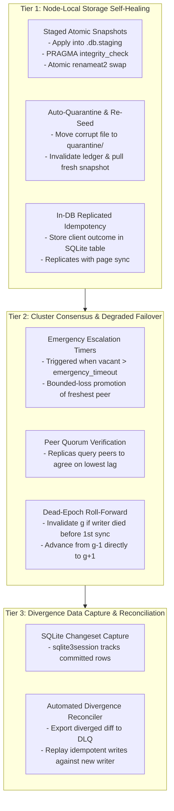

# hasqlite — Automated Failure Recovery & Self-Healing Architecture

This document specifies the post-v1 architecture, protocols, and configuration for
transitioning hasqlite from an operator-intervened, fail-closed posture during severe
anomalies to an automated, self-healing system with strictly bounded risk.

The normative invariants defined in the [safety contract](safety-contract.md) remain
authoritative. Automated recovery mechanisms operate within or explicitly parameterize
those boundaries.

---

## 1. Problem Statement and Philosophy

### 1.1 The v1 Fail-Closed Posture
In hasqlite v1, failover is automated only for clean, single-point failures:
- A writer node dies $\to$ candidate candidates wait out the monotonic TTL $\to$ freshest replica acquires and activates via CAS $\to$ promotes to writer.
- A writer loses coordination $\to$ self-fences at `renew_deadline_secs` $\to$ demotes.

However, during edge-case cluster degradation or storage anomalies, v1 intentionally
**fails closed** to prioritize data safety over availability:
1. **All replicas exceed `max_lag_secs`**: Promotion is denied cluster-wide; cluster halts until an operator manually overrides or force-promotes.
2. **Activated writer dies before 1st replica sync**: Replicas hold snapshots from generation $g-1$, but lease requires writer epoch $g$; failover blocks.
3. **Replica corruption or torn snapshot**: Freshness ledger is invalidated; replica is unpromotable and cannot heal without operator intervention.
4. **Divergent former writer reconnects**: Database preserved as `*.diverged-g<gen>`; orphaned commits remain stranded on local disk.
5. **Client "outcome unknown" across failovers**: Network failure between `COMMIT` and response leaves clients unable to safely retry mutating queries.

### 1.2 The Self-Healing Objectives
Post-v1 introduces deterministic self-healing protocols to:
- **Minimize Mean Time to Recovery (MTTR)** without sacrificing single-writer safety.
- **Convert manual runbooks into bounded, auditable state machine transitions**.
- **Guarantee idempotency and zero duplicate execution** across client retries.



---

## 2. Tier 1: Node-Local Storage Self-Healing

### 2.1 Staged Atomic Snapshots (Track N Evolution)
In-place page application risks leaving a database file torn if a crash, power outage,
or disk write failure occurs mid-sync.

1. **Shadow Application**: The sync worker pulls and writes snapshot pages into a
   temporary shadow file on the same filesystem: `<database-path>.staging`.
2. **Integrity Verification**: Prior to publication, the sync engine runs:
   ```sql
   PRAGMA integrity_check;
   ```
   and validates that page BLAKE3 hashes match origin-stamped checksums.
3. **Atomic Replace**:
   To prevent existing connections from accessing stale inodes while new connections access
   the replacement database, and to safely handle WAL/journal sidecars:
   - Acquire an internal controller replacement lock that blocks new read handle checkouts
     and pauses candidate promotion campaigning.
   - Quiesce open SQLite reader connections by draining or closing active handles.
   - Clean up any inactive WAL or shared-memory sidecars (`-wal`, `-shm`, `-journal`) on the live path.
   - Execute the atomic replacement:
     - On Linux: `renameat2(AT_FDCWD, staging_path, AT_FDCWD, live_path, RENAME_EXCHANGE)`.
     - On macOS/BSD or legacy filesystems: atomic replace via temp-file + rename.
   - Fsync the replacement database file and fsync the containing database directory.
   - Reopen reader connections against the new database file.
   - Release the controller replacement lock to resume promotion evaluations.
4. **Ledger Publication**: Only after the replacement database file and containing directory
   have been fsynced, publish the updated freshness ledger using the crash-safe sequence
   (write to temp file, `fsync`, rename to `.hasqlite.freshness`, and `fsync` the parent directory).

### 2.2 Auto-Quarantine and Automated Re-Seed
If a replica detects database corruption (`SQLITE_CORRUPT`, bad checksums, or storage I/O errors):
1. **Ledger Invalidation (Immediate)**: The node first unlinks `.hasqlite.freshness` and
   fsyncs its parent directory. If a crash or power failure occurs immediately afterward,
   the node reboots strictly unpromotable, preventing a damaged or empty database from promoting.
2. **Database Quarantine**: Move the suspect database file and any remaining sidecars to quarantine:
   ```
   mv /var/lib/hasqlite/data.db /var/lib/hasqlite/quarantine/<timestamp>_data.db
   ```
   and fsync the directory.
3. **Self-Demotion**: The node transitions to `Role::DegradedReplica` and sets `/ready` to 503.
4. **Automated Seed Clone**: The sync worker issues a streaming full-snapshot pull from
   the active writer or a designated healthy peer. Once complete and verified with
   `PRAGMA integrity_check`, the node re-enters normal replica sync and re-enables promotion eligibility.

### 2.3 In-DB Replicated Idempotency
To solve the "outcome unknown" dilemma where client writes commit but the network fails
before the client receives the acknowledgment:
1. **Internal Schema**:
   ```sql
   CREATE TABLE IF NOT EXISTS _hasqlite_idempotency (
       client_id TEXT NOT NULL,
       idempotency_key TEXT NOT NULL,
       statement_fingerprint TEXT NOT NULL,
       response_payload BLOB NOT NULL,
       committed_at_secs INTEGER NOT NULL,
       PRIMARY KEY (client_id, idempotency_key)
   );
   ```
2. **Atomic Execution**: On mutating gRPC requests carrying an `idempotency_key`, the SQL
   gateway writes the response payload into `_hasqlite_idempotency` within the **exact same**
   SQLite transaction as the user's SQL statement.
3. **Deduplication across Replicated Commits (Bounded Guarantees)**: Because SQLite page
   replication syncs the entire database state, the idempotency table is transferred to all
   standby replicas as part of ordinary snapshots.
   - **Guaranteed Scope**: Deduplication is guaranteed for all commits that were durably
     replicated to the promoted replica prior to writer failure.
   - **Asynchronous Replication Boundary**: Commits accepted by the former writer within the
     unreplicated lag window are not present on the promoted replica. When a client retries
     such a transaction, no record exists in `_hasqlite_idempotency` on the new writer, so the
     statement will execute as a new transaction. True zero-loss deduplication across any crash
     requires a synchronous replication barrier (e.g. semi-synchronous commit ack) where the
     writer does not acknowledge the client until at least one replica persists the idempotency record.
   - **Retry Verification Steps**: When a client retries a request against a newly promoted writer:
     1. The writer queries `_hasqlite_idempotency` for `(client_id, idempotency_key)`.
     2. If found, it compares the stored `statement_fingerprint` with the incoming request's fingerprint.
     3. If the fingerprints match, it returns the cached `response_payload` without re-executing the SQL.
     4. If the fingerprints differ, it rejects the request with an `IDEMPOTENCY_KEY_COLLISION` error.
     5. If not found, it executes the statement normally in a new transaction.
4. **Retention Window**: A background pruner purges idempotency entries older than
   `idempotency.retention_period_secs` (default: 24 hours).

---

## 3. Tier 2: Cluster Consensus & Degraded Failover

### 3.1 Emergency Escalation Timers for Stale Replicas
When a writer dies after being partitioned or stalled, replica lag may exceed
`freshness.max_lag_secs`. Safety contract Rule 10 denies promotion to prevent unbounded data loss.

In post-v1, an automated **Emergency Promotion Protocol** can be enabled:

```
[Normal Window: 0 .. lease.ttl_secs]
  Candidates observe expired version. Standard validate_promotion (lag <= max_lag_secs).

[Grace Window: lease.ttl_secs .. emergency_timeout_secs]
  Cluster remains halted; replicas wait for writer recovery or catch-up sync.

[Emergency Window: t > emergency_timeout_secs]
  Candidates enter Degraded Promotion mode.
```

#### Protocol:
1. **Trigger Condition**:
   - Local candidate clock measures lease version unchanged for `recovery.emergency_promotion_timeout_secs`
     (default: $3 \times \text{TTL}$, e.g. 30 seconds).
   - No healthy writer has renewed the lease.
2. **Peer Consensus Ping**:
   - The candidate queries all known cluster peers over gRPC: `rpc GetFreshnessState(Empty) returns (FreshnessLedger)`.
   - A candidate proceeds **only if**:
     a. Counting the candidate's own local state as one vote, a quorum ($\lfloor N/2 \rfloor + 1$ of total cluster nodes, e.g. candidate + 1 reachable peer in a 3-node cluster) participates in the freshness comparison, AND
     b. Its own `synced_at_secs` is $\ge$ all reachable peers participating in the comparison (freshest surviving replica).
3. **Emergency CAS Acquisition & Bounded Lag Gate**:
   - The candidate evaluates its actual lag against the activated writer's last renewal:
     $$\text{lag} = \text{writer.renewed\_at\_secs} - \text{candidate.synced\_at\_secs}$$
   - If $\text{lag} > \text{recovery.max\_emergency\_lag\_secs}$, the candidate **rejects acquisition** and aborts promotion, strictly enforcing the maximum configured emergency data loss bound.
   - If $\text{lag} \le \text{recovery.max\_emergency\_lag\_secs}$, the candidate issues an `acquire` CAS writing metadata annotation `emergency_promotion = true`.
   - It records an explicit audit entry: `EMERGENCY_PROMOTION_ACCEPTED: lag=<actual_lag_secs>, max_emergency_lag=<config_max>`.
4. **Activation**: The candidate activates and resumes write service.

### 3.2 Dead-Epoch Roll-Forward Protocol
When a newly promoted node activates as writer at generation $g$ but crashes before any
replica completes a sync:
- The lease records writer epoch `(node_dead, g, t_renew)`.
- All surviving replicas hold ledgers from generation $g-1$.
- Standard promotion is blocked because `source_generation (g-1) != writer.generation (g)`.

#### Automated Roll-Forward:
1. **Dead Generation Detection**:
   - Lease version remains unchanged for `recovery.dead_epoch_timeout_secs` (default: $2 \times \text{TTL}$).
   - The last recorded writer renewal timestamp `writer.renewed_at_secs` is stagnant.
2. **Quorum Attestation**:
   - Candidates exchange signed attestations: `Attestation { peer: id, max_observed_generation: g-1 }`.
   - If a quorum of replicas confirms zero snapshots received from generation $g$, generation $g$
     is certified as an **Orphaned Dead Epoch**.
3. **Superseding Acquisition**:
   - Candidate executes a CAS targeting generation $g+1$, asserting source epoch $g-1$.
   - The lease store grants generation $g+1$ and updates `writer = (candidate_id, g+1, now)`.
   - Write traffic resumes with zero manual intervention.

### 3.3 Clock Skew Auto-Backoff
If a writer's clock is running fast and stamps snapshot timestamps ahead of a candidate's
local wall clock, `validate_promotion` denies promotion under the future-skew rule.

Instead of failing permanently:
1. The controller computes the required skew wait time:
   $$\Delta t = \text{snapshot.synced\_at\_secs} - \text{candidate.now\_wall\_secs} - \text{max\_future\_skew\_secs}$$
2. The controller automatically arms a backoff timer for $\Delta t + 500\text{ms}$.
3. Once elapsed, the candidate automatically re-evaluates `validate_promotion` without
   requiring pod restarts or operator intervention.

---

## 4. Tier 3: Divergent Data Capture & Reconciliation

When a partitioned writer commits writes locally past its renewal deadline and later demotes,
Rule 15 preserves its database as `*.diverged-g<gen>`. Post-v1 automates data recovery from
these files.

### 4.1 SQLite Changeset Stream
1. **Schema Validation & Primary Key Requirements**:
   The SQLite session extension (`sqlite3session`) requires every tracked table to have an
   explicit primary key; tables without primary keys (or rows with NULL primary-key columns)
   cannot be captured by the session module.
   - **Pre-requisite Validation**: Replicated schemas require explicit, non-null primary keys on
     all user tables (standard primary key or `WITHOUT ROWID`).
   - **Authorizer Enforcement**: The SQL gateway authorizer rejects `CREATE TABLE` statements that
     omit an explicit primary key whenever divergence tracking is enabled.
2. **Session Attachment**:
   ```c
   sqlite3session_create(db, "main", &session);
   sqlite3session_attach(session, NULL); // attach all valid tables
   ```
3. **Crash-Safe Changeset Archival**:
   To prevent an unrecoverable gap between a SQLite transaction commit and durable changelog storage:
   - **Atomic In-Transaction Capture**: Changesets are serialized and recorded in an internal append-only
     table (`_hasqlite_changesets`) within the **same SQLite transaction** before `COMMIT`. This guarantees
     that transaction commit and changeset persistence are mutually atomic and crash-safe.
   - **Sidecar Commit Hook Protocol**: If external files are used (`changesets/gen-<g>-<tx_id>.bin`),
     the writer registers a `sqlite3_commit_hook`. The hook writes and fsyncs the changeset before the commit
     can succeed; any I/O failure aborts the SQLite commit.
   - **Recovery Fallback on Log Gap**: If on restart a sequence gap is detected in the changeset archive
     (e.g. transaction count exceeds durable changesets), divergence recovery marks the archive incomplete
     and falls back to full table diffing against the ancestor snapshot.

### 4.2 Automated Divergence Reconciler
When a former writer re-attaches as a replica:
1. **Detection**: The supervisor identifies `/var/lib/hasqlite/*.diverged-g<gen>`.
2. **Diff Extraction**: The reconciler invokes SQLite's `sqlite3session_diff()` API to compute the
   changeset diff comparing the diverged database state against the common snapshot ancestor.
3. **Dead-Letter Queue (DLQ) Export**:
   - Orphaned rows are exported to a structured audit file:
     `/var/lib/hasqlite/diverged/diverged-g<gen>-export.jsonl`.
   - An alert is emitted: `hasqlite_diverged_commits_exported_total`.
4. **Automated Replay (Configurable)**:
   - If `recovery.auto_reconcile_divergence = true`, the reconciler connects to the new writer
     via gRPC and replays idempotent `INSERT` operations carrying conflict resolution policies
     (`INSERT OR IGNORE`). Conflicting updates remain in the DLQ for manual inspection.

---

## 5. Tier 4: Planned Switchover Fallback Policies

During a planned switchover (e.g. rolling upgrade or pod termination), the current writer
stops accepting writes, waits for replicas to sync the post-stop state, and then releases the lease.

If replica synchronization times out during shutdown:
```toml
[recovery.planned_switchover]
# Options: "abort" (keep old writer active), "force_handover" (bounded loss failover)
on_sync_timeout = "abort"
timeout_secs = 10
```

1. **`abort` (Safety-preferred)**:
   - If the old writer's host is still healthy (e.g. maintenance aborted or rescheduled),
     cancel the demotion, reopen `/ready`, and resume serving traffic.
2. **`force_handover` (Availability-preferred)**:
   - If the pod is under forced Kubernetes termination (`preStop` deadline approaching),
     release the lease and mark `lossless_switchover = false` in the audit log. The freshest
     eligible replica promotes under standard failover rules.

---

## 6. Configuration Contract Extensions

```toml
[recovery]
# Enable automated emergency promotion when all replicas exceed max_lag_secs
auto_emergency_promotion = false
emergency_promotion_timeout_secs = 30
max_emergency_lag_secs = 300
require_peer_quorum = true

# Enable automated roll-forward when writer dies before any replica syncs
auto_dead_epoch_recovery = false
dead_epoch_timeout_secs = 20

# Replica self-healing and quarantine
auto_quarantine_corrupt_replicas = true
max_quarantined_files = 5

# Divergence reconciliation
auto_export_diverged_commits = true
auto_reconcile_divergence = false

[idempotency]
# Enable replicated transactional idempotency tables
enabled = true
retention_period_secs = 86400
max_payload_bytes = 1048576

[recovery.planned_switchover]
on_sync_timeout = "abort"
timeout_secs = 10
```

---

## 7. Verification and Test Matrix

The following fault-injection scenarios validate automated recovery in `tests/chaos/`:

| Test Case | Fault Injected | Automated Recovery Assertion |
| :--- | :--- | :--- |
| `auto_emergency_lag_failover.rs` | Partition writer until all replicas exceed `max_lag_secs`; kill writer. | Cluster waits `emergency_promotion_timeout_secs`; freshest replica wins quorum and promotes; audit entry emitted. |
| `auto_dead_epoch_rollforward.rs` | Kill newly activated writer before replica sync starts. | Replicas detect dead epoch; quorum agreement advances $g-1 \to g+1$; cluster recovers without manual runbook. |
| `auto_replica_quarantine.rs` | Corrupt 4 random pages in replica database during operation. | Replica catches `SQLITE_CORRUPT`, moves file to `quarantine/`, triggers full seed pull, and recovers to healthy standby. |
| `replicated_idempotency_failover.rs` | Client issues mutating write with idempotency key; kill writer immediately after SQLite `COMMIT`. | Client retries same key against new writer; receives exact cached response; statement executed exactly once. |
| `diverged_changeset_export.rs` | Writer stalled beyond fencing margin; commits diverged row; reconnected as replica. | Diverged file detected; diff extracted into JSON-L DLQ; node re-syncs cleanly. |

---

## 8. Development Milestones

1. **Phase 6a — Storage Self-Healing & Idempotency**:
   - Implement Track N staged apply with integrity gates.
   - Implement replica auto-quarantine and automated initial seed clone.
   - Implement in-DB `_hasqlite_idempotency` table and gRPC deduplication filter.
2. **Phase 6b — Degraded Cluster Failover**:
   - Add emergency escalation timers and gRPC peer-freshness querying to `hasqlite-controller`.
   - Implement dead-epoch detection and roll-forward CAS protocol.
3. **Phase 6c — Divergence CDC & Reconciliation**:
   - Implement `sqlite3session` changeset hooks and DLQ export engine.
   - Add configurable automated replay policies.